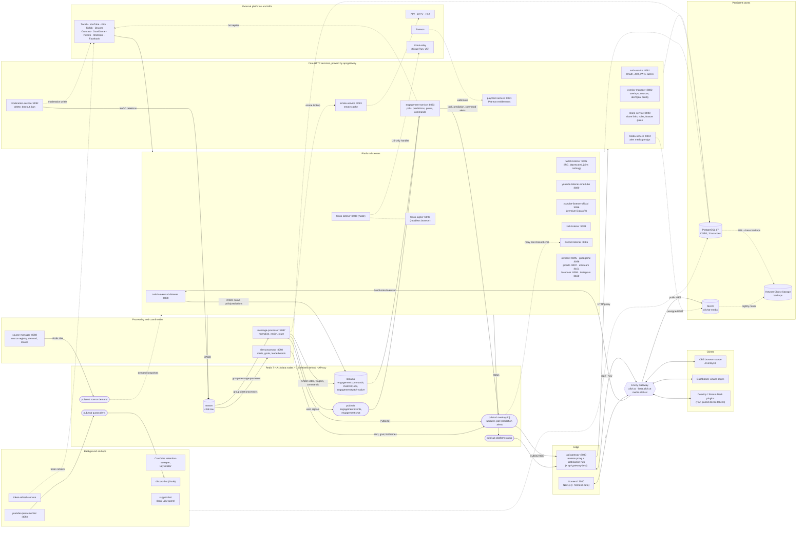

# All-Chat: Architecture Overview

**Version**: 3.0
**Last Updated**: 2026-11-04
**Status**: Production

---

## Table of Contents

1. [Introduction](#introduction)
2. [Architecture Principles](#architecture-principles)
3. [System Overview](#system-overview)
4. [Service Map](#service-map)
5. [Technology Stack](#technology-stack)
6. [Message Flow](#message-flow)
7. [Design Decisions](#design-decisions)
8. [Further Reading](#further-reading)

---

## Introduction

All-Chat is a **cloud-native microservices platform** for aggregating and displaying chat messages from multiple live streaming platforms on streaming overlays. Twitch, YouTube, Kick, TikTok and Discord are generally available; Owncast, GoodGame, Picarto, Facebook and Instagram are beta-only, and Altstream is early access (the per-platform rollout state lives in `CLAUDE.md` and `frontend/src/lib/platform-availability.ts`).

**Core Value Proposition**: Unified chat display for multi-platform streamers, supporting 7TV, BTTV, and FFZ emotes with real-time updates. Around the chat overlay sit alerts, goal and list overlays, polls, predictions and a viewer points economy, streamer chat commands, and cross-platform moderation.

**Architecture Philosophy**:
- **Standard Go Layout** (not hexagonal) - LLM-friendly, less boilerplate
- **Microservices** - Clear boundaries, independent scaling
- **Cloud-native** - Kubernetes (K3s), CNPG (PostgreSQL), LGTM observability stack, GitOps
- **LLM-first development** - Optimized for code generation by AI agents

---

## Architecture Principles

### Key Design Principles

1. **Horizontal Scalability**: Stateless services scale to N replicas; listeners coordinate through leases and demand snapshots instead of a single leader
2. **Fault Tolerance**: Services are resilient to dependency failures (ring buffers in front of Redis, consumer-group PEL recovery, Redis and PostgreSQL failover)
3. **Separation of Concerns**: Each service has a single, well-defined responsibility
4. **Modularity**: Platform listeners are pluggable; a platform is enabled per deployment and gated per user via feature gates (ADR-0008)
5. **Observability**: Prometheus metrics, structured Zap logs, OpenTelemetry traces (LGTM stack)
6. **Eventual Consistency**: Acceptable for non-critical paths (emote cache, metadata, viewer points earning)

### Non-Goals (Explicit Constraints)

- **Not a chat archive** - Chat is transient: `chat:raw` is a sliding window (approx. `MAXLEN` 100,000 entries) and delivery to overlays is fire-and-forget Pub/Sub. Only derived state is persisted (alert history, points, poll results), and the retention sweeper enforces the privacy-policy retention periods (ADR-0089).
- **Not a general-purpose chat bot** - All-Chat does write to platform chat, but only on the streamer's behalf: send-to-all, engagement and chat-command replies, and moderation actions (ADR-0017, ADR-0028, ADR-0079).
- **Not automated moderation** - Moderation is manual actions by the streamer or delegated overlay moderators (ADR-0048); there is no spam detection of its own. Platform-side AutoMod events are surfaced, not decided (ADR-0054).
- **Not multi-region** - Single cluster. The one exception is `tiktok-relay`, a small US-region Cloud Run relay for TikTok handle lookups.

---

## System Overview

### Full Architecture

Every deployed component and the paths between them, laid out left to right along the chat pipeline: platforms, listeners, Redis, processing, gateway, clients. Solid arrows carry chat and events; dotted arrows are control, persistence or outbound paths. Database access is drawn once per group rather than per service.



Ports are the `containerPort` values in the production manifests; `deployments/docker-compose.yml` uses its own assignments for some services. Not drawn, to keep the picture readable: every Go service also uses Redis for caches, rate limits and leases; overlay-manager publishes test alerts and goal frames to `overlay:{id}:alerts`; the gateway proxies `/api/v1/test-stream` to message-processor; alert-processor polls platform APIs for follower/subscriber goals; Prometheus, Loki and Tempo scrape or receive from every pod; `support-bot` talks to Discord and reads Grafana, GitHub and the cluster for its tools.

### Where it runs

- **Production**: a K3s cluster (HA control plane, separate worker nodes), managed by ArgoCD from the `caesar-deployment` GitOps repository (`apps/workloads/all-chat/`). Keel rolls deployments when a new `:main` or `:beta` image is pushed by `.github/workflows/build-and-push.yml`. Database migrations run as an `allchat-migrations` init container in front of the services that own schema.
- **beta.allch.at**: `frontend-beta` and `api-gateway-beta` run the `:beta` images next to prod and share every backend service with it. The beta-platform listeners (facebook, goodgame, instagram, owncast, picarto) run from `:beta` only; everything else runs from `:main`.
- **Local development**: `deployments/docker-compose.yml` (`make docker-up`, `make frontend-dev`). The manifests in `deployments/k8s/` are for a local k3d cluster, not production.

Details: [02-DEPLOYMENT.md](./02-DEPLOYMENT.md).

---

## Service Map

Each service has its own README under `services/`; the table links the ones that exist. Ports are production `containerPort`s; replica counts and HPAs live in [02-DEPLOYMENT.md](./02-DEPLOYMENT.md) and [03-SCALING.md](./03-SCALING.md) because they change often.

### Edge

| Service | Port | Responsibility |
|---|---|---|
| frontend | 3000 | Next.js App Router UI: dashboard, overlay editor, OBS overlay pages (`/overlay/[id]`) |
| [api-gateway](../../services/api-gateway/README.md) | 8080 | Single public entry for `/api/` and `/ws/`: reverse proxy to the core services (`models/service_config.go`), JWT/PAT checks, WebSocket hub subscribing to `overlay:{id}*` channels |

### Core HTTP services

| Service | Port | Responsibility |
|---|---|---|
| [auth-service](../../services/auth-service/README.md) | 8081 | Streamer and viewer OAuth (Twitch, YouTube, Kick, TikTok, Discord, Facebook/Instagram), JWT key chain, personal access tokens and paired device tokens (ADR-0049, ADR-0051), admin user APIs; its image also runs the `retention-sweeper` (ADR-0089) and `key-rotator` CronJobs |
| [overlay-manager](../../services/overlay-manager/README.md) | 8082 | Overlay CRUD, chat sources per overlay, alert profiles, goal/list overlay configuration, test alerts |
| [emote-service](../../services/emote-service/README.md) | 8083 | 7TV / BTTV / FFZ emote aggregation and cache |
| share-service | 8090 | Shareable overlay links, admin role grants (premium, beta tester, ambassador) and feature gates, ambassador showcase (ADR-0041), localization contribution tool (ADR-0063), UI language gate (ADR-0066) |
| [moderation-service](../../services/moderation-service/README.md) | 8092 | Cross-platform moderation write path (ADR-0017); publishes deletions back into `chat:raw` so overlays drop the message |
| [payment-service](../../services/payment-service/README.md) | 8091 | Patreon webhooks and reconcile; writes `users.is_premium` and `viewers.is_premium` (ADR-0018, ADR-0019) |
| [engagement-service](../../services/engagement-service/README.md) | 8093 | Polls, predictions and per-overlay viewer points (#523), Twitch-native poll/prediction mirroring (ADR-0030), streamer chat commands, keyword triggers, timers, clips and images (ADR-0079, ADR-0080, ADR-0081) |
| [media-service](../../services/media-service/README.md) | 8094 | Registry and presigned uploads for alert media in MinIO (ADR-0068, ADR-0071); never serves bytes |

### Platform listeners

All listeners publish raw messages to the `chat:raw` stream and connection state to `platform:status`. Most follow `source:demand` snapshots from source-manager so they only connect to channels some overlay needs.

| Service | Port | Platform and protocol |
|---|---|---|
| [twitch-eventsub-listener](../../services/twitch-eventsub-listener/README.md) | 8090 | Twitch chat and events via EventSub (webhooks at `/webhooks/eventsub`); the only Twitch chat path in production (ADR-0026). Also feeds `engagement:twitch-native` |
| [twitch-listener](../../services/twitch-listener/README.md) | 8085 | Twitch IRC, **deprecated** (ADR-0026). Production runs it in `enforce` mode: it joins no channels |
| [youtube-listener-innertube](../../services/youtube-listener-innertube/README.md) | 8080 | YouTube chat via InnerTube polling for every channel not claimed by the official listener; no quota cost for chat, optional subscriber-alert polling spends accounted Data API units |
| [youtube-listener](../../services/youtube-listener/README.md) | 8086 | Deployed as `youtube-listener-official`: Data API / gRPC chat for opted-in, owner-verified premium channels (unlisted and members-only streams), with reserve-confirm-rollback quota accounting (ADR-0006, ADR-0065) |
| [kick-listener](../../services/kick-listener/README.md) | 8089 | Kick realtime: Centrifugo (pooled, up to 100 chatrooms per connection) or Pusher, whichever Kick serves at startup (ADR-0077) |
| [tiktok-listener](../../services/tiktok-listener/README.md) | 8089 | TikTok Live via an unofficial library (Node); signing by `tiktok-signer`, US handle lookups via `tiktok-relay` (ADR-0052, ADR-0064) |
| [tiktok-signer](../../services/tiktok-signer/README.md) | 8092 | Self-hosted TikTok webcast signing with TikTok's own SDK in a headless browser (ADR-0052) |
| [tiktok-relay](../../services/tiktok-relay/README.md) | n/a | US-region Cloud Run relay for TikTok live lookup by handle; not in the cluster |
| discord-listener | 8086 | Discord channel chat in, and relay of non-Discord overlay chat out to a Discord channel |
| [owncast-listener](../../services/owncast-listener/README.md) | 8095 | Owncast chat websocket, instance URL as channel (ADR-0058). Beta |
| [goodgame-listener](../../services/goodgame-listener/README.md) | 8096 | GoodGame.ru chat websocket. Beta |
| [picarto-listener](../../services/picarto-listener/README.md) | 8097 | Picarto pop-out chat websocket, defensively parsed (ADR-0059). Beta |
| [altstream-listener](../../services/altstream-listener/README.md) | 8101 | Altstream official SSE chat API, `lastId` mandatory, read-only (ADR-0082). Early access |
| [facebook-listener](../../services/facebook-listener/README.md) | 8099 | Facebook Live comments via Graph API polling; moderation via moderation-service (ADR-0060). Beta |
| [instagram-listener](../../services/instagram-listener/README.md) | 8100 | Instagram Live `live_comments` polling, read-only (ADR-0062). Beta |

### Processing and coordination

| Service | Port | Responsibility |
|---|---|---|
| [message-processor](../../services/message-processor/README.md) | 8087 | Consumer group `message-processor` on `chat:raw`: per-platform normalization, emote enrichment with bounded concurrency (ADR-0033), 60 s age cutoff (`MESSAGE_AGE_CUTOFF_SECONDS`), publish to `overlay:{id}`; forwards vote/wager and chat-command candidates to the engagement streams |
| [alert-processor](../../services/alert-processor/README.md) | 8098 | Second consumer group `alert-processors` on `chat:raw`: routes event messages to alerts/goal/list overlays on `overlay:{id}:alerts`, persists `alert_events`, scores leaderboards, counts bits/Super Chat goals, polls follower/subscriber goals (ADR-0068, ADR-0070, ADR-0072) |
| [source-manager](../../services/source-manager/README.md) | 8088 | Active source registry (DB sync + LISTEN/NOTIFY), `ActivateSource` calls from listeners, `source:demand` snapshots for listeners, leadership lease API (ADR-0007). Source liveness is kept by the gateway and listener heartbeats (ADR-0032) |

### Background jobs

| Service | Port | Responsibility |
|---|---|---|
| [token-refresh-service](../../services/token-refresh-service/README.md) | 8090 | Refreshes stored platform OAuth tokens before expiry; single replica |
| [youtube-quota-monitor](../../services/youtube-quota-monitor/README.md) | 8093 | Reads the shared YouTube quota table, exports the quota metric, publishes `quota:alerts` (ADR-0023) |
| retention-sweeper (CronJob) | n/a | Enforces privacy-policy retention periods every 15 minutes (ADR-0089) |
| key-rotator (CronJob) | n/a | Weekly (Sundays 03:00 UTC) re-encryption of stored tokens onto the versioned encryption keys (`shared/encryption/versioned.go`) until the legacy key is retired |

### Community and ops

| Service | Port | Responsibility |
|---|---|---|
| [discord-bot](../../services/discord-bot/README.md) | n/a | TypeScript community bot; posts `quota:alerts` and quota status to Discord |
| [support-bot](../../services/support-bot/README.md) | 8094 | Go Discord support/admin agent over a locally hosted OpenAI-compatible LLM with code-enforced tool access |

---

## Technology Stack

### Backend

| Technology | Purpose | Version |
|------------|---------|---------|
| **Go** | Microservices language | 1.26 (`go.mod`) |
| **Node.js / TypeScript** | tiktok-listener, tiktok-signer, tiktok-relay, discord-bot | - |
| **Gin** | HTTP framework | Latest |
| **pgx/v5** | PostgreSQL driver | v5 |
| **go-redis/v9** | Redis client | v9 |
| **Zap** | Structured logging | Latest |
| **gorilla/websocket** | WebSocket server/client | Latest |
| **golang-jwt/jwt** | JWT authentication | v5 |
| **OpenTelemetry** | Tracing (`shared/tracing/`) | - |

### Frontend

| Technology | Purpose | Version |
|------------|---------|---------|
| **React** | UI library | 19 |
| **Next.js** | SSR framework | 16 (App Router) |
| **TypeScript** | Type safety | Latest |
| **Tailwind CSS + shadcn/ui** | Styling and primitives (ADR-0056) | Latest |

### Infrastructure

| Technology | Purpose | Version |
|------------|---------|---------|
| **K3s** | Kubernetes distribution, HA control plane | - |
| **ArgoCD** | GitOps sync from `caesar-deployment` | - |
| **Keel** | Image-push driven rollouts | - |
| **Envoy Gateway** | Gateway API ingress, TLS via cert-manager | - |
| **CloudNativePG** | PostgreSQL operator | PostgreSQL 17 (prod), 16 in local compose |
| **Redis** | Streams, Pub/Sub, caches; Sentinel + HAProxy for HA | 7.4 |
| **MinIO** | Object storage for alert media | - |
| **Hetzner Object Storage** | Off-site backups (Barman Cloud WAL + base backups, media mirror) | - |
| **Prometheus / Grafana / Loki / Tempo** | Metrics, dashboards, logs, traces | - |

---

## Message Flow

### End-to-End Chat Pipeline

```
1. Platform → Listener
   Chat arrives (EventSub webhook, websocket, SSE, or poll)
   ↓
2. Listener → Redis Streams
   XADD to chat:raw (approx. MAXLEN 100,000; ring buffer absorbs Redis blips)
   ↓
3. Redis Streams → Message Processor
   Consumer group message-processor (XREADGROUP); alert-processor reads the
   same entries through its own group alert-processors
   ↓
4. Message Processor - Filter and normalize
   Drop messages older than the age cutoff; platform format → UnifiedChatMessage
   ↓
5. Message Processor - Enrich
   7TV/BTTV/FFZ emotes, badges, username colour (ADR-0047), pronouns
   ↓
6. Message Processor → Redis Pub/Sub
   PUBLISH to overlay:{overlay_id} for every overlay that carries the source
   ↓
7. Redis Pub/Sub → API Gateway
   Gateway pods subscribe per connected overlay (overlay:{id}, :updates, :poll,
   :prediction, and :alerts for alerts/goal/list overlays)
   ↓
8. API Gateway → Frontend
   WebSocket broadcast to the overlay's clients
   ↓
9. Frontend - Render
   Display message with emotes in the overlay
```

**Latency targets** (P95, design budget rather than a measurement; see [04-OBSERVABILITY.md](./04-OBSERVABILITY.md) for the metrics that track it):
- Listener → Redis Streams: <50ms
- Redis Streams → Processor: <100ms
- Processor (normalize + enrich): <300ms
- Processor → Redis Pub/Sub: <50ms
- Redis Pub/Sub → Gateway: <50ms
- Gateway → Frontend: <50ms
- **Total P95**: <500ms (listener → overlay display)

Alerts, engagement and moderation flows: [01-DATA-FLOW.md](./01-DATA-FLOW.md).

### Unified Message Format

All platforms are normalized to `UnifiedChatMessage` (`services/message-processor/models/message.go`). Abbreviated:

```json
{
  "id": "uuid",
  "overlay_id": "uuid",
  "platform": "twitch",
  "channel_id": "platform-channel-id",
  "channel_name": "DisplayName",
  "user": {
    "id": "platform-user-id",
    "username": "username",
    "display_name": "DisplayName",
    "badges": [{ "name": "subscriber", "version": "12", "icon_url": "https://..." }],
    "color": "#FF0000",
    "auto_color": "#1E90FF"
  },
  "message": {
    "text": "Hello world!",
    "emotes": [
      { "code": "Kappa", "provider": "twitch", "url": "https://...", "positions": [[0, 4]] }
    ],
    "attachments": []
  },
  "timestamp": "2026-01-28T10:00:00Z",
  "metadata": {},
  "event": null
}
```

`platforms` (send-to-all collapse, ADR-0024), avatar, gradient, pronoun and shared-chat source-badge fields are optional; `event` is set for subscriptions, bits, raids and other platform events. The struct is the reference, not this sample.

---

## Design Decisions

### Why Standard Go Layout (Not Hexagonal)?

**Decision**: Use Standard Go project layout, not ports/adapters hexagonal architecture.

**Rationale**:
- 60% less boilerplate code
- LLMs generate more accurate code (familiar patterns)
- Go community standard (examples, tutorials align)
- Easier to onboard new developers
- Testing still straightforward with dependency injection

**→ Details**: [ADR-0001: Standard Go Layout](../adr/0001-standard-go-layout.md)

### Why Redis Streams + Pub/Sub Hybrid?

**Decision**: Use Redis Streams for durable message queue + Redis Pub/Sub for low-latency broadcast.

**Rationale**:
- **Streams**: Durable, consumer groups, backpressure-capable (`chat:raw`, engagement streams)
- **Pub/Sub**: Low-latency, fan-out to many subscribers (`overlay:*`)
- One Redis deployment (made highly available with Sentinel + HAProxy), simpler than Kafka/NATS
- 100-500ms latency achievable (vs 2-5s with Kafka)

**Trade-offs**:
- Pub/Sub not durable (messages lost if subscriber crashes); state that must not be lost (votes, wagers, native poll lifecycle) goes through streams instead
- Memory grows with subscriber count

**→ Details**: [ADR-0002: Redis Streams + Pub/Sub](../adr/0002-redis-streams-pubsub.md)

### Why CloudNativePG?

**Decision**: Use CloudNativePG operator for PostgreSQL instead of manual StatefulSet.

**Rationale**:
- Team has production experience with CNPG
- Automated failover
- PITR (Point-in-Time Recovery) built-in
- Continuous WAL archiving and nightly base backups to S3-compatible storage
- Rolling updates with zero downtime

**→ Details**: [ADR-0003: CloudNativePG](../adr/0003-cloudnative-postgres.md)

### Why React + Next.js?

**Decision**: Use React 19+ with Next.js 16+ (App Router) for frontend.

**Rationale**:
- LLMs excel at generating React code
- SSR for SEO and initial load performance
- App Router for server components (reduced bundle size)
- TypeScript for type safety
- Large ecosystem of UI libraries

**→ Details**: [ADR-0005: React + Next.js](../adr/0005-react-nextjs-frontend.md)

### Why Reserve-Confirm-Rollback Quota Tracking?

**Decision**: Use atomic database reservations for YouTube API quota tracking instead of simple counter.

**Problem**: Simple counter had ±500 units/day drift (5% error), risking quota exhaustion.

**Solution**:
- Reserve quota BEFORE API call (atomic database operation)
- Confirm if call succeeds (move reserved → used)
- Rollback if 4xx client error (release reservation)
- Cleanup stale reservations every 60 seconds (crash recovery)

Today only the premium official listener and InnerTube's optional subscriber-alert polling spend Data API quota; regular chat ingestion goes through InnerTube at no quota cost (ADR-0065).

**→ Details**: [ADR-0006: YouTube Quota Tracking](../adr/0006-youtube-quota-tracking.md)

---

## Further Reading

### Architecture Documentation

- **[01-DATA-FLOW.md](./01-DATA-FLOW.md)** - Detailed message flow, Redis patterns
- **[02-DEPLOYMENT.md](./02-DEPLOYMENT.md)** - Kubernetes deployment, infrastructure
- **[03-SCALING.md](./03-SCALING.md)** - Scaling strategies, performance bottlenecks
- **[04-OBSERVABILITY.md](./04-OBSERVABILITY.md)** - Metrics, logging, tracing, alerts
- **[05-SECURITY.md](./05-SECURITY.md)** - Security architecture, threat model

### Architecture Decision Records (ADRs)

- **[ADR Index](../adr/README.md)** - All ADRs with status and context
- **[ADR-0001](../adr/0001-standard-go-layout.md)** - Standard Go Layout (not hexagonal)
- **[ADR-0002](../adr/0002-redis-streams-pubsub.md)** - Redis Streams + Pub/Sub hybrid
- **[ADR-0003](../adr/0003-cloudnative-postgres.md)** - CloudNativePG operator
- **[ADR-0004](../adr/0004-no-hexagonal-architecture.md)** - No ports/adapters abstraction
- **[ADR-0005](../adr/0005-react-nextjs-frontend.md)** - React + Next.js frontend
- **[ADR-0006](../adr/0006-youtube-quota-tracking.md)** - YouTube quota reserve-confirm-rollback

### Service Documentation

Service READMEs: [services/*/README.md](../../services/) (discord-listener and share-service have none yet).

### Quick Reference Guides

- **[QUICK-REF-ADD-PLATFORM.md](../llm-guides/QUICK-REF-ADD-PLATFORM.md)** - Add new platform
- **[QUICK-REF-DEBUG-QUOTA.md](../llm-guides/QUICK-REF-DEBUG-QUOTA.md)** - YouTube quota debugging
- **[QUICK-REF-SCALING.md](../llm-guides/QUICK-REF-SCALING.md)** - Scale services

### Troubleshooting

- **[Troubleshooting Decision Tree](../troubleshooting/decision-tree.md)** - High-level triage for common issues

---

## Current Status

**Production**:
- ✅ Twitch (EventSub), YouTube (InnerTube + premium Data API), Kick, TikTok, Discord live; beta/early-access platforms as listed in [Platform listeners](#platform-listeners)
- ✅ CloudNativePG cluster with continuous backups to Hetzner Object Storage
- ✅ Redis HA (Sentinel + HAProxy)
- ✅ LGTM observability stack (Loki, Grafana, Prometheus, Tempo); Prometheus metrics via `shared/metrics/`, tracing via `shared/tracing/`
- ✅ HPAs on the platform listeners
- ✅ AES-GCM token encryption (`shared/encryption/`, versioned key rotation)
- ✅ Rate limiting (`shared/ratelimit/`)
- ✅ Kubernetes NetworkPolicies as the service-to-service isolation control

**Known Limitations**:
- Service-to-service request signing exists in `shared/signing/` but is not wired into any production service (see [05-SECURITY.md](./05-SECURITY.md) and `docs/security/RESIDUALS.md`)
- Single PostgreSQL database shared by all services; connections are budgeted per pod (ADR-0039)
- YouTube Data API quota: 1,009,000 units/day
- facebook-listener and instagram-listener are deployed but inert: auth-service (and moderation-service for Facebook) has no Meta app credentials yet, so no streamer can connect either platform
