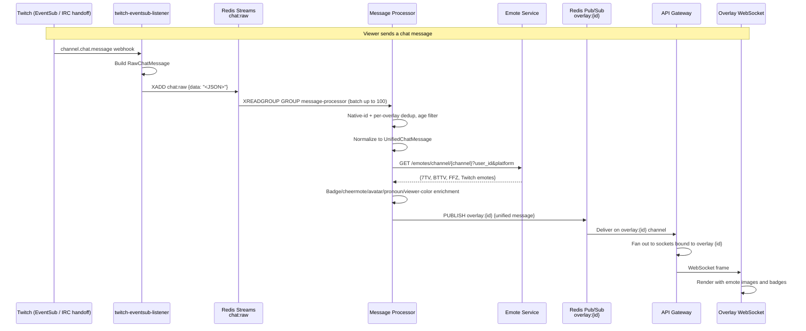
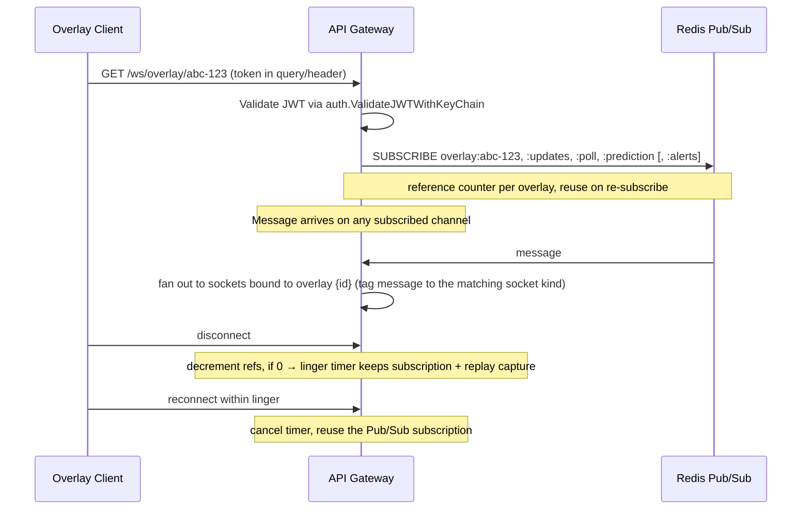
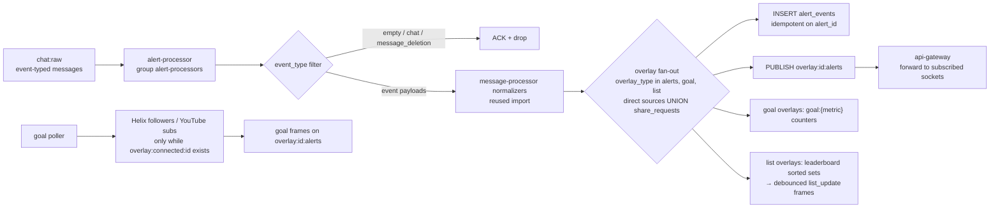
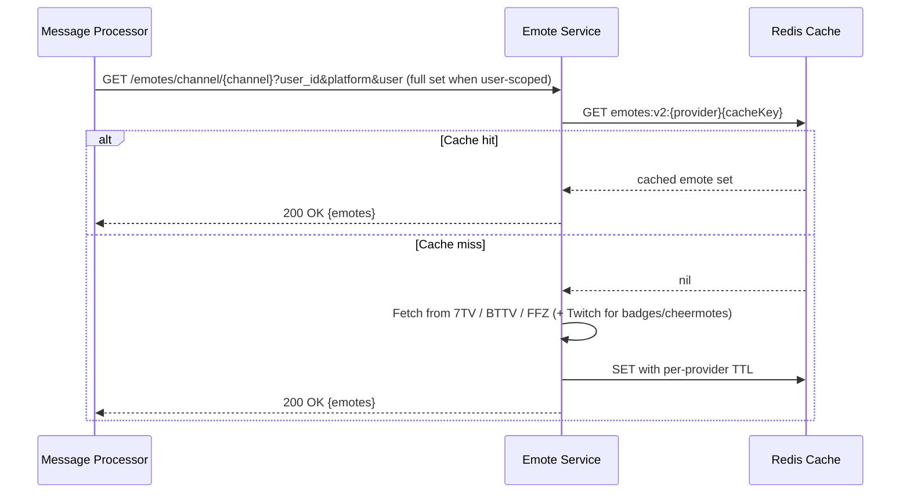
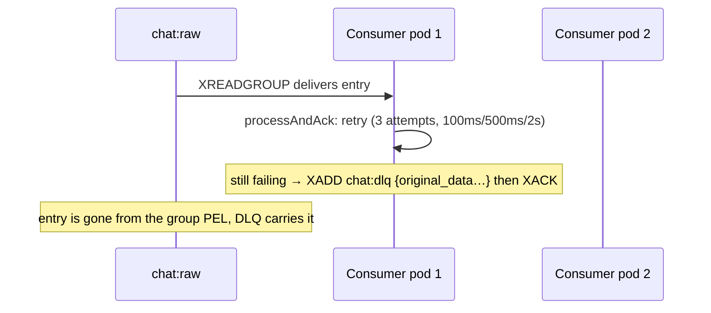

# All-Chat: Data Flow & Integration Architecture

**Last Updated:** 2026-11-04
**Related Docs**: [System Overview](./00-OVERVIEW.md), [Deployment](./02-DEPLOYMENT.md), [Scaling](./03-SCALING.md)
**ADRs**: see the [ADR index](../adr/README.md) — ADR-0001, ADR-0002 (Redis Streams + Pub/Sub hybrid), ADR-0007 (leadership rebalancing), ADR-0031 (websocket replay), ADR-0032 (heartbeat), ADR-0033 (processor concurrency), ADR-0047 (username color), ADR-0065 (YouTube listener split), ADR-0068 (alerts), ADR-0070 (alerts overlay editor variants), ADR-0072 (goal/list overlays), ADR-0079 (chat commands), ADR-0082 (Altstream).

---

## Table of Contents

1. [Introduction](#introduction)
2. [End-to-End Message Flow](#end-to-end-message-flow)
3. [Streams Consumers and Groups](#streams-consumers-and-groups)
4. [Redis Pub/Sub Architecture](#redis-pubsub-architecture)
5. [Redis Key Inventory](#redis-key-inventory)
6. [Alerts, Goal and List Flow](#alerts-goal-and-list-flow)
7. [Engagement Flow (points, commands, polls, predictions)](#engagement-flow-points-commands-polls-predictions)
8. [Moderation (Deletion) Flow](#moderation-deletion-flow)
9. [Unified Message Format](#unified-message-format)
10. [Integration Patterns](#integration-patterns)
11. [Error Handling & Retry Logic](#error-handling--retry-logic)
12. [Performance Considerations](#performance-considerations)

---

## Introduction

All-Chat uses a **hybrid messaging architecture** combining:
- **Redis Streams**: durable queues for reliable processing (`chat:raw`, plus the engagement command and native-event streams)
- **Redis Pub/Sub**: low-latency broadcast to WebSocket clients (`overlay:{id}` and its per-feature sub-channels)
- **PostgreSQL**: persistent state, configuration, message history and the alert ledger

This document details how messages flow from streaming platforms through the system to overlay displays, and how services integrate with each other. Pair it with the [system overview](./00-OVERVIEW.md) for the full-service diagram.

---

## End-to-End Message Flow

### Complete System Flow



**Latency claims**: none in this document are measurements — the per-stage table below only names stages. End-to-end latency is dominated by cache hits and upstream fan-out and is not asserted numerically here.

### Flow Stages

| Stage | Component | What happens |
|-------|-----------|--------------|
| **1. Capture** | Platform listener | Connect to the platform, parse its protocol, build a `RawChatMessage` |
| **2. Queue** | Redis Streams | `XADD chat:raw` with the JSON in the `data` field (ring-buffer retry wraps each listener's publish) |
| **3. Consume** | Message-processor | Consumer group `message-processor`, batches up to 100, in-batch worker pool of 16 (`MP_PROCESS_CONCURRENCY`, ADR-0033) |
| **4. Filter/Dedup** | Message-processor | Drop messages older than the age cutoff, drop duplicate native ids (ADR-0015), per-overlay dedup, event-type filtering |
| **5. Normalize** | Message-processor normalizers | One normalizer per platform produces a `UnifiedChatMessage` (see [normalizers](#platform-normalizers)) |
| **6. Enrich** | Message-processor enrichers | Avatars, badge icons, emotes (7TV/BTTV/FFZ via emote-service), cheermotes, viewer identity/color (ADR-0047), pronouns |
| **7. Route+Publish** | Message-processor | Resolve target overlays from the DB (direct sources UNION shared-overlay fan-out), `PUBLISH overlay:{id}` per target |
| **8. Broadcast** | API Gateway | Subscribed per-overlay, forwards to connected WebSocket clients; captures into the chat replay buffer |

### Producers on `chat:raw`

Every listener publishes to `chat:raw` with the payload JSON in a single **`data`** field, wrapped in a shared ring-buffer publisher so transient `XADD` failures are retried; the stream is trimmed with `MAXLEN ~100000` (`shared/listener` ring-buffer publisher, per-listener `StreamKey`/`chatStreamKey` constants). Listeners that publish today (see `services/` for the current set):

- `twitch-eventsub-listener` (Twitch EventSub webhooks; primary Twitch path, ADR-0026 supersedes the deprecated `twitch-listener`, which now runs with prod configured so it joins **no channels** and only publishes deprecation notices)
- `youtube-listener-innertube` (InnerTube polling, quota-free ingestion for unclaimed channels, ADR-0065; publish only happens after its startup canary/creds checks pass — see `services/youtube-listener-innertube/cmd/main.go`)
- `youtube-listener` (deployed as `youtube-listener-official`, premium official-API mode, ADR-0065)
- `kick-listener` (Centrifugo/Pusher, ADR-0077)
- `tiktok-listener` (unofficial TikTok library; signed by `tiktok-signer`, US-region handle lookups via `tiktok-relay`)
- `discord-listener` (channel relay)
- `owncast-listener`, `goodgame-listener`, `picarto-listener`, `altstream-listener` (beta platforms, ADR-0058/0059/0082 and goodgame README)
- `facebook-listener`, `instagram-listener` (beta platforms, ADR-0060/0062)
- `message-processor`'s **chatcmd forwarder** is *not* a producer on `chat:raw` — it unconditionally uses a separate key (`chatcmd:jobs`); see the [engagement flow](#engagement-flow-points-commands-polls-predictions).

`source-manager` does **not** publish to `chat:raw`; the source lifecycle it manages is HTTP-facing and DB-backed (`services/source-manager/README.md`), plus the DB-backed leader election and the `source:demand` Pub/Sub snapshots described in [Source-manager and leadership](#source-manager-and-leadership). Listeners subscribe to that demand channel with the shared SDK (`shared/listener/demand.go`) — the discord-listener, the youtube-listener pair and tiktok-listener each run a subscriber (tiktok's is `src/demand/subscriber.ts`) — and start/stop polling as snapshots change.

### Consumer groups on `chat:raw`

Two independent consumer groups run concurrently over the same stream (ADR-0002):

| Group | Service | Purpose |
|-------|---------|---------|
| `message-processor` | message-processor | Chat normalization + enrichment + overlay fan-out |
| `alert-processors` | alert-processor | Event-typed messages → alerts, goals, list leaderboards (ADR-0068, ADR-0072) |

The groups are independent by design (ADR-0002): a pod joining one group does not see the other's pending entries. The alert group is created with `XGROUP CREATE` **without `MKSTREAM`** so a fresh deployment where no listener has yet published does not fabricate the stream.

The message-processor consumer reads up to 100 entries per `XREADGROUP` with a 5s block, then drives them through a bounded in-batch worker pool (default concurrency 16, `MP_PROCESS_CONCURRENCY`, ADR-0033). Entries are ACKed after processing succeeds; failures go through retry then the dead-letter queue (see [Error Handling & Retry Logic](#error-handling--retry-logic)).

---

## Streams Consumers and Groups

| Stream | Producer | Consumer group | Notes |
|--------|----------|----------------|-------|
| `chat:raw` | every listener (see above), plus `moderation-service` deletions (see [Moderation flow](#moderation-deletion-flow)) and `twitch-listener` deprecation notices (`listener_deprecation_notice` system events consumed by the message-processor `system_normalizer`) | `message-processor`, `alert-processors` | both with their own PEL |
| `chat:dlq` | message-processor (dead-letter; drained manually by `POST /admin/dlq/replay`, handler in `services/message-processor/handlers/dlq.go`) | (none — replayed by hand) | fields: `original_stream_id`, `source_service`, `failure_reason`, `retry_count`, `original_data`, `dlq_timestamp` |
| `chatcmd:jobs` | message-processor (chat-command forwarding) | engagement-service command consumer | MAXLEN trimmed by `engagementCommandsMaxLen` so a stalled engagement-service cannot grow it unbounded |
| `engagement:commands` | message-processor (chat-command command payloads, ADR-0079) | engagement-service command consumer | durable; sessions/wagers resolve through it |
| `engagement:twitch-native` | twitch-eventsub-listener (native engagement-domain events: subs/donation/gift challenges etc.) | engagement-service native consumer | stream max length bounded |

Italicised detail: streams above are constant strings in `services/message-processor/models/engagement.go` and `services/message-processor/models/chatcmd.go`. No `chat:*` name should be assumed beyond this table; new names come from each source file.


## Redis Pub/Sub Architecture

### Channel Pattern: `overlay:{overlay_id}`

**Purpose**: Broadcast enriched messages to the WebSocket clients of one overlay.

| Channel | Producer | Emitted payload |
|---------|----------|-----------------|
| `overlay:{id}` | message-processor, alert-processor (alert envelopes), engagement-service (chat-command image deliverables and other command reactions) | `UnifiedChatMessage`, alt-set `Alert`/`GoalFrame`/`ListUpdateFrame` payloads |
| `overlay:{id}:updates` | message-processor | `UnifiedChatMessage` with `Event.IsUpdate` (TikTok like aggregates currently) — delivered in place of the main channel for update semantics |
| `overlay:{id}:alerts` | alert-processor (ADR-0068/0072), engagement-service (command-triggered alerts) | `shared/alerts.Alert` / `GoalFrame` / `ListUpdateFrame` envelopes |
| `overlay:{id}:poll` | engagement-service | `PollSnapshot` |
| `overlay:{id}:prediction` | engagement-service | `PredictionSnapshot` |
| `quota:alerts` | youtube-quota-monitor (via `shared/quota` Notifier) | quota event payloads for the discord-bot (ADR-0023) |
| `platform:status` | each listener's status publisher | listener up/down liveness (ADR-0032) |
| `source:demand` | source-manager (`demand/subscriber.go`) | full-replacement `DemandUpdate` snapshot: which listeners should be polling which platform/channel, derived from the api-gateway's `overlay:connected:*` keys |

`overlay:{id}` and `overlay:{id}:updates` are the message-processor chat channels; the alert/goal/list frames and the engagement snapshots land on their own sub-channels so chat-only and alert-only sockets can subscribe selectively (see below).

#### Why Pub/Sub Instead of Streams?

Streams are chosen when durability and consumer-group fan-out matter (the `chat:raw` pipeline, engagement commands, native events). Pub/Sub is chosen for overlay broadcast: ultra-low latency, already-processed payload, multiple API Gateway instances receiving the same message, and ephemeral loss is acceptable since clients reconnect and replay from the gateway's buffers (ADR-0031).

#### Publisher: Message Processor

```go
// services/message-processor/publisher/pubsub_publisher.go (abridged)
channel := "overlay:" + overlayID
if update := msg.Event != nil && msg.Event.IsUpdate; update {
    channel = "overlay:" + overlayID + ":updates"
}
err := retryPublish(ctx, func() error { return p.client.Publish(ctx, channel, string(jsonStr)).Err() })
```

Retry via `retryPublish` (per MP-04), a bounded per-publish retry with logging and a `publish_retry_total` metric.

#### Subscriber: API Gateway

The API Gateway groups subscriptions per overlay (`services/api-gateway/subscription/subscriber.go`):

```go
// channelsFor(overlayID, viewerOnly, withAlerts):
//   overlay:{id}
//   overlay:{id}:updates (omitted for viewer-only sockets)
//   overlay:{id}:poll, overlay:{id}:prediction
//   overlay:{id}:alerts (only when overlay kind is alerts/goal/list — withAlerts)
```

- The subscription is **decoupled from the socket lifetime** with a linger window (default 5 min, `lingerDuration`): when the last connection for an overlay drops, the Pub/Sub subscription stays open so messages arriving during the gap keep landing in the chat replay buffer (ADR-0031) `replay:chat:{id}` for replay on reconnect.
- First-connection socket type decides the shape: an OBS socket (`/ws/overlay/{id}`) subscribes the wide set; a viewer-only socket (`viewerParticipant=true`) subscribes just the main channel.
- An OBS socket for a `alerts`/`goal`/`list` overlay also gets `overlay:{id}:alerts`; a later chat-kind joiner upgrades only the alerts channel if the original subscription lacked it.



Deletion events are replayed from a separate bounded Redis buffer `replay:deletions:{id}` (TTL 60s) so a reconnecting overlay sees the removals it missed.

---

## Redis Key Inventory

The channel patterns above plus these key families (verified against the code; names may continue to gain suffixes in `shared/` and per-service packages):

| Key | Writer | Purpose |
|-----|--------|---------|
| `chat:raw`, `chat:dlq` | see streams table | pipeline + dead-letter |
| `chatcmd:channels` | engagement-service (`ChannelSync`, atomically replaced via a `:tmp:` key then `RENAME`) | set of `platform:channel_id` members whose chat message-processor must forward to `chatcmd:jobs` |
| `chatcmd:jobs` | message-processor | job stream consumed by engagement-service |
| `engagement:commands`, `engagement:twitch-native` | message-processor, twitch-eventsub-listener | durable engagement work streams |
| `engagement:events`, `engagement:chat` | message-processor (earn republish, throttled chat activity) | earn accounting inputs (Pub/Sub channels per `models/engagement.go`) |
| `engagement:channels:{engagementID}` | engagement-service publisher | broadcast per-engagement inventory |
| `engagement:active:{platform}:{channel_id}` | engagement-service | current activity engagement for a channel (lowercased both halves) |
| `overlay:{id}:goal:{metric}` | alert-processor goals poller | goal counts (bits, Super Chats, followers, subscribers) |
| `overlay:{id}:goal-poll-lock` | alert-processor poller | SetNX leader lock so only one replica polls per interval |
| `overlay:{id}:goal-status` | alert-processor goals poller | why the last poll could not produce a count (`"reconnect"`, `"hidden"`); absent on success |
| `overlay:{id}:goal-counted:{alertID}` | alert-processor | idempotency guard for that goal increment |
| `overlay:{id}:leaderboard:{category}` | alert-processor leaderboard | sorted set of summed amount-bearing events, 30-day rolling TTL |
| `overlay:{id}:lb-scored:{alertID}` | alert-processor | dedup marker for a scored alert |
| `overlay:{id}:list-push:{category}` | alert-processor listpush | debounce window/queue for the `list_update` frame |
| `overlay:connected:{id}` | api-gateway | demand/liveness TTL key: an overlay has a live WebSocket. Consulted by the goal poller and scanned (`overlay:connected:*`) by source-manager to build `source:demand` snapshots |
| `replay:chat:{id}`, `replay:chat:{id}:seen:{msgID}` | api-gateway | chat replay buffer (ADR-0031), per-message seen marker |
| `replay:deletions:{id}` | api-gateway | deletion replay buffer (TTL 60s) |
| `msgid:registry:{platform}:{channelID}` | twitch-listener (the only writer) | native-id → internal-id registry for deletion resolution; moderation-service deletions carry `target_uuid` instead so other platforms resolve without it |
| `msgid:deletion_buffer:{platform}:{channelID}:{nativeID}` | message-processor deletion buffer | deletions that arrived before their target message; drained by `platformMessageID` matching (ADR-0046) |
| `emotes:v2:{provider}:{channel}` | emote-service cache | emote-set cache (global Twitch entries 30d, negative entries 15m; per-user keys embed `userID`/`twitchChannel`/`seventvSetID`) |
| `platform:status` | each listener's status publisher | listener liveness (Pub/Sub) |

Not in the list? Do not assume a name from this doc — grep `services/*/` and `shared/` for the constant instead.

---

## Platform Normalizers

One normalizer file per platform under `services/message-processor/normalizer/`:

| Normalizer | Platform | Notes |
|------------|----------|-------|
| `twitch_normalizer.go` | twitch | `Tags["badges"]`, emote positions, event paths via `NormalizeEvent` |
| `youtube_normalizer.go` | youtube | InnerTube and Data API shapes |
| `kick_normalizer.go` | kick | event + badge parsing |
| `tiktok_normalizer.go` | tiktok | like aggregates (`Event.IsUpdate` → `overlay:{id}:updates`) |
| `discord_normalizer.go` | discord | attachments preserved |
| `owncast_normalizer.go` | owncast | beta |
| `goodgame_normalizer.go` | goodgame | beta; deletions arrive as tag-encoded events promoted by `promoteTagDeletion` |
| `picarto_normalizer.go` | picarto | beta |
| `altstream_normalizer.go` | altstream | self-registered message ids (ADR-0082) |
| `facebook_normalizer.go` | facebook | beta, moderation ids in metadata (ADR-0060) |
| `instagram_normalizer.go` | instagram | beta, read-only (ADR-0062) |
| `system_normalizer.go` | system | `listener_deprecation_notice` and other system event types |

---

## Alerts, Goal and List Flow

The **alert-processor** (`services/alert-processor/README.md`) is a read-only sibling of the message-processor: it runs its own consumer group over `chat:raw`, never re-runs the chat pipeline, and never sees the message-processor's PEL.



- The routing query is a UNION of `overlay_chat_sources` and `share_requests` rows, filtered to `overlay_type IN ('alerts','goal','list')` — chat overlays are never flooded with alerts.
- Pure chat (`event_type` empty or `"chat"`), moderation deletions and system notices are ACKed and dropped; the alert-processor reuses the message-processor's case-by-case normalizers — Twitch, YouTube, TikTok, system — to parse `EventData` rather than duplicating the parsing logic.
- Goal overlays with follower (Twitch) or subscriber (YouTube) goals get an API-polling path that runs **only while the overlay is connected** (the `overlay:connected:{id}` demand key from the api-gateway) and uses a `SETNX`-based poll lock (`overlay:{id}:goal-poll-lock`) so two replicas do not double-count an interval. Poll counts are `INCRBYFLOAT overlay:{id}:goal:{metric}`; poller failures latch a goal's `goal-status` marker so the UI does not report a stale zero. YouTube goal polls go through the quota reserve/confirm path (ADR-0006).
- List overlays get Redis sorted sets (`overlay:{id}:leaderboard:{category}`) fed by amount-bearing alerts (bits, gifts, Super Chats), and a debounced 24/7 alert scorer pushes `list_update` frames to `overlay:{id}:alerts` (`services/alert-processor/listpush/`).
- Alert publishing is broadcast-framing agnostic: each overlay decides which alert `event_type` renders from its alert editor profile (ADR-0070); the registering gateway does not filter payload kinds beyond routing channels by `overlay_type`.

See ADR-0068 (alert envelopes and event flow), ADR-0070 (alert overlay editor variants) and ADR-0072 (goal/list overlays) for the decision rationale.

---

## Engagement Flow (points, commands, polls, predictions)

The **engagement-service** (`services/engagement-service/README.md`) keeps the per-overlay viewer points economy, streamer chat commands, keyword triggers, polls and predictions (ADR-0079, issue #523).

- **Earn** (`services/engagement-service/consumer/earn.go`): idempotent awards from (a) event-bearing messages the message-processor republishes onto `engagement:events`, and (b) throttled chat-activity events on `engagement:chat`. Every award is guarded by the `dedup_key` in the points ledger, so a missed exploit or a replay never adds points twice.
- **Chat commands** (ADR-0079): the message-processor holds an in-process copy of `chatcmd:channels` (`chatcmd:channels` is written by engagement-service's `ChannelSync` on change, refreshed periodically on the MP side) and forwards each chat message from a listed channel to the durable `engagement:commands` stream (plus a bounded `chatcmd:jobs` stream for plain jobs). engagement-service's `CommandConsumer` drains it, resolves the durable viewer, applies `min_role` checks (roles are derived from listener tags — Twitch/Kick badges, YouTube `is_owner`/`is_moderator`/is-sponsor flags), evaluates template or JS replies, handles `{urlfetch}`, Twitch clips and command images (images emitted onto `overlay:{id}:alerts` as alert frames, ADR-0080). The parser itself applies the digit and duration validators again rather than trusting the forwarder.
- **Native Twitch events**: `twitch-eventsub-listener` writes native engagement-domain events (subscription/cheer/community-gift lifecycle etc.) to the `engagement:twitch-native` stream; engagement-service consumes it to drive earn awards and community-gift challenges.
- **Polls & predictions**: votes arrive via the API gateway or chat commands. engagement-service writes the vote to Postgres, guards against cross-tenant wagering, then snapshots the poll (`PublishPoll`) onto `overlay:{id}:poll` or `overlay:{id}:prediction` so both OBS overlays and viewer sockets see live state. Wager rounds are kept alive by the native track-replay path if the connection drops mid-round, using native idempotency keyed by a dedup token.

---

## Moderation (Deletion) Flow

The **moderation-service** implements the cross-platform moderation write path (ADR-0017: delete/timeout/ban). Its **read side of the pipeline** is a deletion emitter:

- The message-processor's `message_deletion` handler resolves the deletion against the registry deletion buffer and `msgid:registry:{platform}:{channelID}` (only twitch-listener populates the registry; moderation-service deletions carry `target_uuid` direct, and self-registered platforms like Altstream register their ids post-publish, ADR-0082). If the deletion overtakes its target, it is buffered in `msgid:deletion_buffer:{platform}:{channelID}:{nativeID}` (TTL 60s) and drained when the target message is published (ADR-0046).
- The resolved deletion is normalized (deletion path of the per-platform normalizers), then published to `overlay:{id}` so the gateway can swap the affected message frame; the gateway also keeps `replay:deletions:{id}` so a reconnecting overlay replays missed removals.

---

## Unified Message Format

### Raw producer shape on `chat:raw`

Every listener serialises a `RawChatMessage`-shaped JSON into the single `data` field:

```go
// services/message-processor/models/message.go (abridged)
type RawChatMessage struct {
    MessageID   string            `json:"message_id"`
    Platform    string            `json:"platform"`
    OverlayID   string            `json:"overlay_id,omitempty"`
    ChannelID   string            `json:"channel_id"`
    ChannelName string            `json:"channel_name,omitempty"`
    UserID      string            `json:"user_id"`
    Username    string            `json:"username"`
    Text        string            `json:"text"`
    Timestamp   time.Time         `json:"timestamp"`
    Tags        map[string]string `json:"tags"`
    Attachments []Attachment      `json:"attachments,omitempty"`
    RawMessage  json.RawMessage   `json:"raw_message,omitempty"`

    // Event support (omitted for chat messages)
    EventType string                 `json:"event_type,omitempty"` // "subscription", "raid", "like_aggregate", ...
    EventData map[string]interface{} `json:"event_data,omitempty"`
}
```

Platform-specific extra data lives in `Tags` (Twitch/Kick/Glyph tag tokens) and `RawMessage`, not in a fixed schema; listeners are free to omit `overlay_id` (the message-processor resolves targets itself).

### Normalized consumer shape

```go
// services/message-processor/models/message.go (abridged)
type UnifiedChatMessage struct {
    ID          string                 `json:"id"`
    OverlayID   string                 `json:"overlay_id"`
    Platform    string                 `json:"platform"`     // may be overridden when Platforms is set
    Platforms   []string               `json:"platforms,omitempty"` // send-to-all collapse: every platform echoed
    ChannelID   string                 `json:"channel_id"`
    ChannelName string                 `json:"channel_name"`
    User        UserInfo               `json:"user"`
    Message     MessageInfo            `json:"message"`
    Timestamp   time.Time              `json:"timestamp"`
    Metadata    map[string]interface{} `json:"metadata"`
    Event       *EventInfo             `json:"event,omitempty"`
}

type UserInfo struct {
    ID            string  `json:"id"`
    Username      string  `json:"username"`
    DisplayName   string  `json:"display_name"`
    AvatarURL     string  `json:"avatar_url,omitempty"`
    Badges        []Badge `json:"badges"`
    Color         string  `json:"color,omitempty"` // viewer-chosen colour, else platform-native (ADR-0047)
    AutoColor     string  `json:"auto_color,omitempty"` // deterministic fallback palette
    NameGradient  string  `json:"name_gradient,omitempty"` // cosmetics JSONB, "linear", angle…
    SourceBadges  []Badge `json:"source_badges,omitempty"` // shared-chat source badges
    SourceUserID  string  `json:"source_user_id,omitempty"`
    AvatarFrameURL string `json:"avatar_frame_url,omitempty"`
    AvatarFlairURL string `json:"avatar_flair_url,omitempty"`
    Pronouns      string  `json:"pronouns,omitempty"`
    // TwitchUsername `json:"-"` — internal, never serialized; keys pronoun lookup for non-Twitch chatters
}

type Badge struct {
    Name    string `json:"name"`     // "subscriber", "moderator", …
    Version string `json:"version"`
    IconURL string `json:"icon_url"`
}

type MessageInfo struct {
    Text        string       `json:"text"`
    Emotes      []Emote      `json:"emotes"`
    Attachments []Attachment `json:"attachments,omitempty"`
}

type Emote struct {
    Code      string   `json:"code"`
    Provider  string   `json:"provider"` // "twitch", "7tv", "bttv", "ffz", …
    URL       string   `json:"url"`
    Positions [][]int  `json:"positions"`
}

type Attachment struct {
    Type        string `json:"type"`
    URL         string `json:"url"`
    ContentType string `json:"content_type,omitempty"`
    Width       int    `json:"width,omitempty"`
    Height      int    `json:"height,omitempty"`
    ThumbURL    string `json:"thumb_url,omitempty"`
    Spoiler     bool   `json:"spoiler,omitempty"`
    Filename    string `json:"filename,omitempty"`
}

type EventInfo struct {
    Type          string                 `json:"type"`
    Tier          string                 `json:"tier"`
    Value         *EventValue            `json:"value,omitempty"`
    Duration      int                    `json:"duration"`
    AggregationID string                 `json:"aggregation_id,omitempty"`
    IsUpdate      bool                   `json:"is_update"` // TikTok like aggregates publish on overlay:{id}:updates
    Metadata      map[string]interface{} `json:"metadata,omitempty"`
}

type EventValue struct {
    Amount      float64 `json:"amount"`
    Currency    string  `json:"currency"`
    DisplayText string  `json:"display_text"`
}
```

Notable semantics (from the struct comments in `services/message-processor/models/message.go`):

- `User.Color` is the **authoritative** colour: a viewer-chosen All-Chat colour first, else the platform colour; empty falls back to the streamer's per-overlay setting, then `AutoColor` (ADR-0047). `AutoColor` is a separate deterministic palette field, kept apart so overlays can rank the streamer setting between them. `NameGradient` is a raw JSONB cosmetics string.
- `User.SourceBadges` and `User.SourceUserID` carry shared-chat authorship (badges from the original Twitch channel of a shared-chat message).
- `Platforms` is set only for a streamer "send to all" message whose per-platform echoes were collapsed into one combined message in the publish loop; `Platform` is then the first echo's platform and the singular value is not authoritative.
- `MessageInfo.Attachments` is usually present only for Discord and Facebook/Instagram platform messages (photos, clips, spoilers).
- `Event.IsUpdate` converts the message into a separate Pub/Sub delivery on `overlay:{id}:updates` (currently the TikTok like-aggregate flow only).

### Platform normalizer mapping

The normalizers do not share a rigid layout; they translate flexible platform shapes into the unified struct above and into `Metadata`:

| Platform normalizer | Key transformations |
|---------------------|--------------------|
| Twitch | `Tags` → badges, emotes, color; assumes Twitch event data shape (`NormalizeEvent`) |
| YouTube | InnerTube/Data API authors + superchat amounts → `EventValue` |
| Kick | Kick badges → roleBadges; events (`NormalizeEvent`-style) |
| TikTok | Like aggregates → `Event.IsUpdate` + `AggregationID`; gift maps → `EventValue` |
| Discord | attachments preserved verbatim; colour from platform |
| Facebook / Instagram | moderation ids stored in `Metadata` (ADR-0060) — ingest is read-only on Instagram (ADR-0062) |
| GoodGame, Owncast, Picarto, Altstream | minimal mapping; GoodGame deletions arrive as `Tags`-carried events and are promoted by `promoteTagDeletion` |
| System | `listener_deprecation_notice` and similar go straight to `NormalizeEvent` |

Badges from every platform are normalized into the shared `Badge` struct (`Name`/`Version`/`IconURL`), with platform-specific parsing in `services/message-processor/normalizer/kick_normalizer_badges_test.go` and the role mapping in `services/message-processor/models/chatcmd.go`.

---

## Integration Patterns

### Pattern 1: Synchronous HTTP (Service-to-Service)

**Use case**: message-processor fetching emotes from emote-service.



The emote-service cache namespaces under `emotes:v2` with a per-provider key; global Twitch emotes are cached 30 days, negative results 15 minutes (`services/emote-service/cache/emote_cache.go`). The enricher also caches at the message-processor side (Redis, with a background single-flight refresh per channel — see `services/message-processor/enricher/emote_enricher.go`), so most chat messages never hit emote-service at all.

### Pattern 2: Asynchronous Messaging (Redis Streams)

**Use case**: any listener → message-processor/alert-processor on `chat:raw`; command chains into engagement-service.

- **Decoupling**: listeners and processors are independently deployable and independently scaled.
- **Durability**: entries survive crashes; per-entry ACK restores after failure.
- **Load balancing**: consumer groups fan work across pods of a service.
- **Bounded processing** (ADR-0033): batches up to 100 with bounded concurrent workers so a slow upstream does not stall the group.
- **Streams trims**: `MAXLEN ~100000` for `chat:raw` and small caps on engagement command streams keep Redis stable even when a downstream stalls.

### Pattern 3: Event Broadcasting (Redis Pub/Sub)

**Use case**: message-processor → api-gateway → overlays, plus alert/goal/list and engagement snapshot channels.

- **Fan-out**: one publish, many gateway instances and sockets.
- **Channel enum** (see [Pub/Sub section](#redis-pubsub-architecture)): message-processor/enricher-produced channels plus alert-processor, goal, list, and engagement service channels.
- **Ephemeral**: no storage; loss is healed by the gateway replay buffers (`replay:chat:{id}`, `replay:deletions:{id}`, ADR-0031).
- **Dynamic subscriptions**: subscriptions follow sockets with a linger window, per [Subscriber](#subscriber-api-gateway).

#### Source-manager and leadership

Source-manager owns the multi-listener registry and (for the YouTube listeners) a leader-election API over Redis-expiring locks (`services/source-manager/election/leader.go`, dependencies injected as `client.SetNX/Get/TTL` calls in `services/source-manager/README.md`; callers use the shared library `shared/sourcemanager`):

- `LeaderKeyPrefix = "leader"`, sliding TTL lock (`DefaultLockTTL` 10s, renewed every 5s) with a token-gated release, called through `shared/sourcemanager.Coordinator` (`ClaimLeadership`, `Release`, plus background lease-refresh).
- A 30-second stabilization period (`DefaultRebalanceStabilizationPeriod`) stops a leader flip-split between replicas.
- Source liveness (used by the cleanup jobs and the admin panel) is HTTP-based: listeners call source-manager's `/sources/activate` and `/sources/deactivate` (see `shared/sourcemanager/client.go`) rather than a Redis heartbeat. The api-gateway's own demand signal for live overlays is the TTL key `overlay:connected:{id}` (see ADR-0032 for the gateway demand model).
- **Demand fan-out (ADR-0032)**: the api-gateway marks live overlays with TTL keys `overlay:connected:{id}`; source-manager scans those keys (`overlay:connected:*`) and publishes full-replacement `DemandUpdate` snapshots onto the `source:demand` Pub/Sub channel (`services/source-manager/demand/subscriber.go`). Listeners subscribe via `shared/listener/demand.go` (discord-listener, youtube-listener(-innertube); tiktok has its own `src/demand/subscriber.ts`) and start/stop polling to match demand, so idle channels consume no platform quota.

---

## Error Handling & Retry Logic

### `chat:raw` failure scenarios

#### Producer side (listeners)

Each listener's publish is wrapped in the shared **ring-buffer publisher** (`shared/listener/ring_buffer.go`): a transient `XADD` failure does not drop the message, it is buffered (small per-listener capacity) and retried; overflow drops are surfaced through structured metrics/log fields. This is the LI-01/LI-02/LI-03 hardening.

#### Consumer side (message-processor)



Details (from `services/message-processor/consumer/retry.go`, `dlq.go`):

- Retry is **per message, inside `processAndAck`**, not whole-batch; batches never block on one failing entry.
- DLQ entries carry `original_stream_id`, `source_service`, `failure_reason`, `retry_count`, `original_data`, `dlq_timestamp`. Replay is manual: `POST /admin/dlq/replay` reads up to 100 entries and `XADD`s them back to `chat:raw`, then trims them off the DLQ.
- Consumer-group redelivery still exists as the underlying mechanism for a pod dying mid-process; a sweep reclaims PEL entries idle beyond a threshold and reprocesses them (at-least-once; idempotency comes from the per-overlay dedup and per-alert id).

Alert-processor failure handling: at-least-once with a reclamation sweep of its `alert-processors` group's PEL (idle > 5 min, swept every minute) and `alert_events` idempotent on `alert_id`, so a redelivered alert does not double-write history (see [Alerts flow](#alerts-goal-and-list-flow)).

engagement-service failure handling: command and native-event streams are consumed with explicit **at-least-once durability** (`services/engagement-service/consumer/durability_test.go` covers replays), with the ledger `dedup_key` as the safety net for repeated awards.

### HTTP Request Retries

The Pub/Sub publisher wraps each publish in `retryPublish` (bounded retries, structured logging, `publish_retry_total` metric). Service-to-service HTTP calls (emote enricher, source-manager client, moderation-service client) use per-request timeouts with limited retries, not generic exponential backoff wrappers; the specific policy lives with each client in `services/*/` and `shared/`.

---

## Performance Considerations

### Scaling levers

- **Bounded concurrency** (ADR-0033): the message-processor's in-batch worker pool (`MP_PROCESS_CONCURRENCY`, default 16) is the throughput control; raising it trades Redis/DB/HTTP pressure on the enrichers for a higher ceiling per pod. See [03-SCALING.md](./03-SCALING.md) for HPA settings and per-service replica posture.
- **Emote caching**: two layers (message-processor Redis cache with background refresh; emote-service `emotes:v2` cache) mean most messages do not touch the platform APIs on cache hit.
- **Replay buffers**: the gateway captures into `replay:chat:{id}` regardless of subscription linger, so an overlay reconnect costs one sorted-set read instead of a re-subscribe storm (ADR-0031).
- **Streams trimming**: `chat:raw` MAXLEN ~100000, bounded `chatcmd:*`/`engagement:*` stream lengths.
- **Demand valves**: goal polling and list-push burn time only while an overlay has a live connection (`overlay:connected:{id}`), so idle overlays contribute no platform API spend.

### Batch processing

```go
// services/message-processor/consumer/stream_consumer.go (abridged)
sem := make(chan struct{}, c.concurrency)  // bounded in-batch pool; blocking acquire = backpressure
for _, message := range messages {
    wg.Add(1)
    sem <- struct{}{}
    go func(msg redis.XMessage) { defer wg.Done(); defer func(){ <-sem }()
        if err := c.processAndAck(ctx, msg); err != nil { /* DLQ path */ }
    }(message)
}
wg.Wait() // bound in-flight to batch size; natural backpressure before the next XREADGROUP
```

### Connection pooling

PostgreSQL access is via a shared `pgxpool` helper (`shared/database`), sized via env per service; Redis is go-redis/v9 client (or universal client for alert-processor, which shares one client for stream, pub/sub and sorted sets).

---

## Summary

1. **End-to-End Flow**: platforms → listeners → `chat:raw` → message-processor (normalize/enrich/route) → `overlay:{id*}` Pub/Sub → api-gateway → overlays.
2. **Second chat:raw consumer**: alert-processor, its own `alert-processors` group, feeding alerts/goal/list overlays.
3. **Redis key inventory**: the table under [Redis Key Inventory](#redis-key-inventory) is authoritative for the names cited here.
4. **Unified format**: `RawChatMessage` (producers) and `UnifiedChatMessage` (pub/sub payload), defined in `services/message-processor/models/message.go`.
5. **Engagement & moderation** ride parallel flows: engagement command/native/event/chat channels and the moderation deletion loop re-enter through `chat:raw`.
6. **Errors**: ring-buffer publish on producers, per-message retry + `chat:dlq` + group reclamation on consumers.
7. **Performance**: bounded concurrency, two-tier emote caches, replay buffers and demand-gated polling.

**Next Steps**:
- [02-DEPLOYMENT.md](./02-DEPLOYMENT.md) - Kubernetes deployment specifications
- [03-SCALING.md](./03-SCALING.md) - Detailed scaling strategies
- [04-OBSERVABILITY.md](./04-OBSERVABILITY.md) - Monitoring and alerting

---

**Document Maintainers**: Development Team
**Last Review**: 2026-11-04
