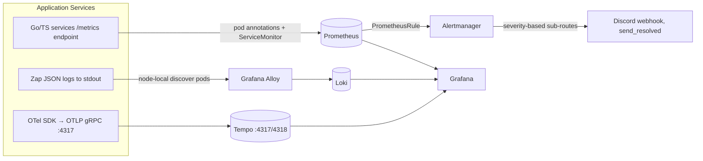
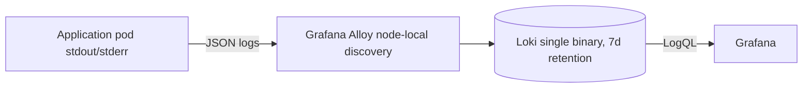

# All-Chat: Observability & Monitoring

**Last Updated**: 2026-11-04
**Status**: Production Ready

---

## Table of Contents

1. [Introduction](#introduction)
2. [Architecture Overview](#architecture-overview)
3. [Metrics (Prometheus)](#metrics-prometheus)
4. [Logging (Loki + Alloy)](#logging-loki--alloy)
5. [Tracing (OpenTelemetry + Tempo)](#tracing-opentelemetry--tempo)
6. [Alerting](#alerting)
7. [Dashboards (Grafana)](#dashboards-grafana)
8. [Scraped Services](#scraped-services)
9. [Related Documentation](#related-documentation)

---

## Introduction

All-Chat implements observability across three pillars:

- **Metrics**: Time-series data (Prometheus via kube-prometheus-stack)
- **Logs**: Structured event data (Zap → Alloy → Loki)
- **Traces**: Request flow tracking (OpenTelemetry → Tempo; ADR-0084 in the caesar-deployment repo describes the Tempo architecture)

The full strategy doc that specifies every metric is [OBSERVABILITY_STRATEGY.md](../OBSERVABILITY_STRATEGY.md); the source of truth for deployed alert rules and dashboards is the ArgoCD GitOps repo (sibling checkout `caesar-deployment`), path `apps/platform/allchat-monitoring/`. Older copies in `deployments/k8s/monitoring/` in this repo lag behind — do not trust them (see ADR-0023 for how alert ownership was moved around).

### Observability Goals

| Goal | Status |
|------|--------|
| **Mean Time to Detect (MTTD)** | Alert rules deployed and routed to Discord |
| **Service Availability** | `up{namespace="allchat"}` + `KubeDeploymentReplicasMismatch` from the kubernetes-mixin |
| **Metric Collection** | Every Go/TS service except `support-bot`, `share-service`, and `discord-bot` exposes `/metrics` (some services with pod annotations, three via ServiceMonitor) |
| **Log Aggregation** | Structured Zap logs from all pods, shipped by Alloy |

---

## Architecture Overview

### Monitoring Stack

| Component | Purpose | Status |
|-----------|---------|--------|
| **Loki** (loki-stack) | Log aggregation & search | ✅ Deployed (single binary, 7-day retention) |
| **Grafana Alloy** | Log scraper (replaces Promtail; DaemonSet-ish node-local discovery) | ✅ Deployed |
| **Prometheus** (kube-prometheus-stack 79.x) | Metrics; 15d local retention | ✅ Deployed |
| **Tempo** (monolithic, ADR-0084) | Distributed tracing; 7-day local-path storage, OTLP gRPC/HTTP on 4317/4318 | ✅ Deployed |
| **Alertmanager** | Alert routing → Discord | ✅ Deployed |
| **Gatus** | Public status page (`apps/workloads/status`, ADR-0085 in the caesar-deployment repo) | ✅ Deployed |
| **Grafana** | Unified dashboards | ✅ Deployed |

No Mimir and no long-term metrics store exist; only the 15-day local Prometheus retention. No PagerDuty: all alert routing goes to Discord.

### Data Flow



Grafana and Alertmanager both post to a Discord webhook (receivers `discord-default`, `discord-critical`, `discord-warning` in `apps/platform/kube-prometheus-stack/helm-values.yaml`); there is no Slack and no PagerDuty.

---

## Metrics (Prometheus)

### Metric Naming Convention

Per-package conventions in `shared/metrics/`:

```
<service-subsystem>_<metric>_<unit>

Examples:
- listener_connection_status            {platform, service, connection_type}
- processor_messages_consumed_total     {service, platform, consumer_group}
- gateway_websocket_connections_active  {service}
```

Common packages (do not invent a second convention in services):

- `shared/metrics/listener.go` — all Go listeners: connection health, sources, messages, rate limits, quota, API calls, errors
- `shared/metrics/processor.go` — message-processor pipeline, emote enrichment, stream lag, DLQ
- `shared/metrics/gateway.go` — api-gateway websockets, overlays, HTTP
- `shared/metrics/business.go` — `allchat_*` business metrics (registration, active users, source operations)
- `shared/metrics/shard_metrics.go` — `shard_*` coordinator coverage and pod-level load

### Critical Metrics

#### Service Health

```promql
# Connection status (1=connected, 0=disconnected); kinds of platforms carried by Go listeners
listener_connection_status{platform="twitch"}
listener_connection_status{platform="youtube"}
listener_connection_status{platform="kick"}

# Kick's dedicated socket gauge (Centrifugo/Pusher, ADR-0077)
kick_listener_socket_state
```

#### Message Throughput

```promql
# Messages per second from Go listeners (canonical shared metric)
rate(listener_messages_received_total[5m])

# Kick messages arrive via kick_listener_messages_total (not the shared listener_* name)
rate(kick_listener_messages_total[5m])

# TikTok (TS side)
rate(tiktok_wire_messages_total[5m])

# Discord
rate(discord_listener_messages_received_total[5m])

# InnerTube YouTube
sum(rate(youtube_listener_messages_published_total[5m]))

# Messages consumed by the processor
rate(processor_messages_consumed_total[5m])

# Messages delivered to overlays (api-gateway)
rate(gateway_messages_sent_total[5m])
```

#### Active Resources

```promql
# Active chat channels/streams (Go listeners)
listener_active_sources_total{platform="twitch"}

# Active overlay viewers
gateway_websocket_connections_active

# Active overlays registered in the system (business metric)
allchat_active_overlays_total
```

#### YouTube Quota (Critical, ADR-0023)

Exported by the single-replica `youtube-quota-monitor` service, which reads the shared quota table and refreshes the gauges; not emitted by the listener itself.

```promql
# Remaining quota units
listener_quota_remaining{platform="youtube"}

# Usage percentage (0-100)
listener_quota_usage_percentage{platform="youtube"}

# Rate limit warnings and hard limits
listener_rate_limit_hits_total{limit_type=~"api_quota_warning|api_quota_critical"}
```

It serves `/quota/status` for the discord-bot and publishes deduped `quota:alerts` Redis events for the discord-bot subscriber. Sends from moderation-service and auth-service are accounted via `shared/quota` (ADR-0023).

#### Performance

```promql
# Message processing latency (P50, P95, P99)
histogram_quantile(0.50, rate(processor_message_processing_duration_seconds_bucket[5m]))
histogram_quantile(0.95, rate(processor_message_processing_duration_seconds_bucket[5m]))
histogram_quantile(0.99, rate(processor_message_processing_duration_seconds_bucket[5m]))

# Per-stage latency
histogram_quantile(0.95, rate(processor_stage_duration_seconds_bucket[5m]))
```

#### Error Rates

```promql
# Error rates by service, rate over all error categories
rate(listener_errors_total[5m])
rate(processor_stream_errors_total[5m])

# Error breakdown by category
sum by (error_category) (rate(listener_errors_total[5m]))
```

### Service-Specific Metrics (verified names)

#### API Gateway (`shared/metrics/gateway.go`)

```go
gateway_websocket_connections_active          // Current active WS connections
gateway_websocket_connections_total           // Total connection attempts
gateway_websocket_connection_duration_seconds // Histogram of connection uptime
gateway_overlay_subscriptions_active          // Active overlay subscriptions
gateway_overlay_subscription_events_total     // Sub/unsub events
gateway_messages_received_total               // From Redis pub/sub
gateway_messages_sent_total                   // Broadcast to clients
gateway_message_delivery_latency_seconds      // Histogram
gateway_messages_dropped_total                // Dropped messages (categories)
gateway_http_requests_total                   // HTTP requests
gateway_http_request_duration_seconds         // HTTP latency histogram
pubsub_reconnect_total                        // Redis pub/sub reconnects
```

#### Message Processor (`shared/metrics/processor.go`)

```go
processor_messages_consumed_total
processor_messages_processed_total
processor_message_processing_duration_seconds
processor_stage_duration_seconds
processor_chat_messages_total             // Text-bearing chat messages by platform
processor_chat_messages_empty_total       // Empty messages filtered out
processor_emote_lookups_total             // By provider + result
processor_emote_cache_entries             // Gauge
processor_emote_cache_operations_total    // hit / miss / set
processor_emote_enrichment_duration_seconds
processor_stream_lag_seconds              // Gauge, Redis XINFO consumer lag
processor_stream_errors_total
processor_messages_published_total
processor_fanout_duration_seconds
processor_deletions_buffered_total
processor_buffered_deletions_applied_total
processor_pel_pending_messages            // Gauge, PEL depth
processor_dlq_messages_total
processor_publish_retry_total
processor_dlq_write_failures_total
processor_engagement_forward_total
```

#### Kick Listener (Independent, ADR-0077)

```go
kick_listener_socket_state                // Gauge; also used by KickListenerDisconnected
kick_listener_messages_total              // By outcome/status/reason
kick_listener_active_subscriptions
kick_listener_subscription_events_total
kick_listener_dropped_messages_total
kick_listener_publish_latency_seconds
kick_listener_reconnects_total
```

#### Shard / Source Manager Metrics

`shared/sourcemanager/metrics.go` emits `source_manager_leadership_*`
(`active`, `desired_total`, `events_total`, `peer_count`, `rebalance_released_total`).
`shared/metrics/shard_metrics.go` emits `shard_*` (per-pod channel counts, healthy/
failed pods, load imbalance, coverage gaps, ghost-pod detection). Wired into the
Go listeners that use the shared coordinator (twitch, kick, goodgame, picarto,
altstream), not into `source-manager` itself.

#### TikTok and Signer Metrics (Node services; ADR-0052, ADR-0064)

```go
tiktok_circuit_breaker_state                  # Gauge
tiktok_circuit_breaker_trips_total
tiktok_connection_subscribers
tiktok_pooled_connections
tiktok_backoff_usernames_stuck
tiktok_backoff_current_interval_ms
tiktok_heartbeat_last_message_timestamp       # Gauge; used for silence detection
tiktok_messages_dropped_total
tiktok_message_queue_size
tiktok_canary_divergences_total               # Drives TikTokCanaryDivergence alert
tiktok_canary_warms_total
tiktok_sign_attempts_total
tiktok_sign_duration_seconds
tiktok_ws_flap_total
tiktok_ws_flap_retries_total
tiktok_ws_flap_exhausted_total
tiktok_ws_lane_pins_total
tiktok_fallback_promotions_total
tiktok_fallback_deliveries_total
tiktok_auto_recovery_total
tiktok_errors_by_type_total
signer_sign_requests_total
signer_sign_request_duration_seconds
signer_session_leases_total
signer_capture_breaker_trips_total
signer_capture_breaker_refusals_total
```

#### Discord Listener (Go, `services/discord-listener/metrics/`)

```go
discord_listener_active_guilds
discord_listener_shard_ownership
discord_listener_gateway_events_total
discord_listener_messages_received_total
discord_listener_messages_published_total
discord_listener_resume_attempts_total
```

#### Token Refresh Service

```go
token_refresh_attempts_total    // By platform + result; alert monitoring in docs/operations/runbooks
token_refresh_errors_total
```

#### Payment Service (Patreon)

```go
payment_patreon_connections                                  // By status; gauge
payment_patreon_reconcile_last_success_timestamp_seconds     // Gauge; drives PatreonReconcileStalled
payment_patreon_unmatched_members_total
```

#### Emote Service

```go
emote_api_calls_total          // calls to 7TV/BTTV/FFZ
```

#### Twitch EventSub Listener

```go
listener_eventsub_chat_owned                  // Gauge; chat ownership claimed
listener_eventsub_revocations_total           // Subscription revocations
listener_eventsub_helix_responses_total       // By code; drives AllChatTwitchEventSubAppTokenRejected
listener_eventsub_app_token_requests_total
eventsub_twitch_migration_sources             // Gauge; by migration_state, ADR-0026
```

#### Auth Service / Sampler (business metrics)

```go
http_requests_total                    // Registered per service by each service's own middleware (auth-service, emote-service, overlay-manager, engagement-service)
http_request_duration_seconds          // Histogram (auth-service, emote-service, overlay-manager each register their own copy)
allchat_user_registrations_total       // Per platform on sign-up; also allchat_viewer_registrations_total on viewer sign-up
allchat_active_users                   // Gauge; per window (24h/7d/30d), used by User Growth dashboard
```

The usage sampler in `services/auth-service/usage/sampler.go` samples active users from the database every `USAGE_SAMPLE_INTERVAL_SECONDS` (default 2 minutes) and updates the `allchat_active_users` gauge per window (24h/7d/30d).

### Infra Metrics

#### PostgreSQL (CNPG via plugin-barman-cloud + cnpg exporter-metrics)

```promql
cnpg_pg_stat_archiver_archived_count                # WAL archived
cnpg_pg_stat_archiver_failed_count                  # WAL archive failures
cnpg_pg_stat_archiver_seconds_since_last_archival   # Drive AllChatPostgresWALArchivingFailing
barman_cloud_cloudnative_pg_io_last_available_backup_timestamp  # Backup freshness (drive AllChatPostgresBackupStale)
```

#### Redis

Lead exporter metrics come from kube-prometheus-stack's `redis-exporter` scraping the Redis-HA sentinel setup. Not separately alertable in this repo — Redis health is watched by `apps/platform` kubernetes-mixin rules and by the runbook at `docs/operations/runbooks/recover-redis-outage.md`.

#### Argo Rollouts

```promql
argo_rollouts_info{name="youtube-listener-innertube"}
argo_rollouts_canary_weight{name="youtube-listener-innertube"}
argo_rollouts_analysis_run_info{rollout="youtube-listener-innertube"}
```

The YouTube InnerTube listener is rolled out as Argo Rollouts canary; the dedicated dashboard tracks the canary weight, error rate and message-rate divergence (`youtube_innertube_canary_messages_total`, `youtube_innertube_canary_polls_total`).

### Deployment Configuration

1. `allchat-listeners` — these three have their `prometheus.io` annotations on the Service (not the pod template), which the pod-discovery job never sees, so they are selected here; selects `twitch-listener`, `kick-listener`, `tiktok-listener`.

2. `allchat-source-manager` — selects `source-manager`.
3. `allchat-services` — selects `message-processor`, `api-gateway`, `auth-service`, `overlay-manager`, `emote-service`, `token-refresh-service`, `tiktok-signer`.

Everything else (all other listeners and services) carries `prometheus.io/scrape: "true"` pod annotations on their pod template and is collected by the kube-prometheus-stack `kubernetes-pods-annotations` pod-discovery job. Mismatches caused silent double series and inflated alert signals before 2026-08-17; the note in servicemonitor.yaml spells out the contract.

Not scraped (by design): `support-bot`, `discord-bot`, the Next.js `frontend`/`frontend-beta` pods, and HPA/PDB objects.

Retention: 15 days on the Prometheus StatefulSet (with persistent PVC to survive kured reboots).

---

## Logging (Loki + Alloy)

### Structured Logging (Zap)

All Go services use the shared `logger` package (`shared/logger`), built on Zap in production mode, emitting JSON with a `service` field and per-event metadata:

```go
// shared/logger: serviceName is embedded on every entry
log := logger.NewLogger("my-service", "info")
log.Info("Message published",
    zap.String("platform", "twitch"),
    zap.String("channel", "xqc"),
)
```

Output shape:

```json
{
  "level": "info",
  "ts": "2026-11-04T10:00:00.000Z",
  "service": "twitch-listener",
  "msg": "Message published",
  "platform": "twitch",
  "channel": "xqc"
}
```

Log level per service comes from `LOG_LEVEL` env (set in prod manifests). The TS services (tiktok-listener, tiktok-signer, tiktok-relay, discord-bot) use their own structured loggers but JSON on stdout as well.

### Log Shipping

**Grafana Alloy** replaced Promtail (see `apps/platform/loki-stack/alloy-values.yaml`). Alloy discovers pods node-local (`spec.nodeName=<self>`) to avoid duplicate tails, filters to Running phase, and applies labels from the k8s metadata:

```
namespace = "allchat"
app       = <deployment name>   (used by alerts and dashboards)
pod       = <pod name>
```

Retention is 7 days (`retention_period: 168h` in `loki-stack/loki-values.yaml`).

### Useful LogQL Queries

#### Find Errors in a Service
```logql
{app="youtube-listener-innertube"} |= "level\":\"error\"" | json
```

#### YouTube Quota Exhaustion (youtube-quota-monitor + quota path)
```logql
{app=~"youtube-listener-official|youtube-quota-monitor"} |= "quota" |= "EXHAUSTED" | json
```

#### WebSocket Connection Drops
```logql
{app="api-gateway"} |= "websocket" |= "disconnect" | json
```

#### EventSub Revocation Events
```logql
{app="twitch-eventsub-listener"} |= "EventSub subscription revoked" | json
```
(used inside the runbook text of `AllChatTwitchSubscriptionMassRevocation`)

### Log Aggregation Pipeline



---

## Tracing (OpenTelemetry + Tempo)

**Status**: ✅ Live. Tempo is deployed monolithic per ADR-0084 in the caesar-deployment repo, 2026-11-01.

### Shared Tracing Package

Most Go services wire in `github.com/caesar/all-chat/shared/tracing` (`grep -l shared/tracing services/*/cmd/*.go` lists them; engagement-service, moderation-service, share-service, discord-listener, youtube-listener-innertube, youtube-quota-monitor and support-bot currently do not):

```go
tracingCfg := tracing.Config{
    ServiceName:    "my-service",
    ServiceVersion: getEnvOrDefault("APP_VERSION", "dev"),
    Environment:    getEnvOrDefault("ENVIRONMENT", "development"),
    OTLPEndpoint:   getEnvOrDefault("OTEL_EXPORTER_OTLP_ENDPOINT", "localhost:4317"),
    Enabled:        true,
}
shutdownTracer, err := tracing.InitTracer(tracingCfg, log)
```

It provides OTLP gRPC export, Gin HTTP tracing middleware, a context propagator, and a configurable sampler (including an always-sample-errors wrapper, `shared/tracing/sampler.go`). Initialization failure is logged and the service continues without tracing; it never hard-fails.

The TS services (tiktok-listener, tiktok-signer) use `@opentelemetry/auto-instrumentations-node`, also OTLP gRPC.

### OTEL Environment (prod, `apps/workloads/all-chat/configmap.yaml`)

```yaml
OTEL_EXPORTER_OTLP_ENDPOINT: "tempo.monitoring.svc.cluster.local:4317"
OTEL_EXPORTER_OTLP_PROTOCOL: "grpc"
OTEL_SERVICE_NAME: "allchat"        # overridden per deployment, e.g. "allchat-api-gateway"
OTEL_RESOURCE_ATTRIBUTES: "deployment.environment=production,service.namespace=allchat"
OTEL_TRACES_SAMPLER: "parentbased_traceidratio"
OTEL_TRACES_SAMPLER_ARG: "0.1"      # 10% sampling in production
```

OTEL_ENABLED is set explicitly to `"true"` on the handful of services that have both endpoints and the tracing library wired (`alert-processor`, `engagement-service`, `media-service`, `moderation-service`, `overlay-manager`, `payment-service`, `share-service`, `tiktok-listener`).

### Retention

Tempo retains traces for 168h (7 days) on a local-path 10Gi PVC, pinned to a single node. The metrics-generator is off.

---

## Alerting

Source of truth is `caesar-deployment/apps/platform/allchat-monitoring/` (ADR-0022 there decoupled alert ownership so a single Prometheus+Alertmanager rule set, plus its promtool test files in `tests/`, governs everything). The three rule files define 43 alert rules (critical / warning / info tiers).

### Critical Alerts (`allchat-critical-alerts.yaml`)

| Alert | Trigger (abbrev.) | Notes |
|-------|-------------------|-------|
| YouTubeQuotaExhausted | `max(listener_quota_usage_percentage{platform="youtube"}) >= 100`, 1m | Quota monitor exports the gauge, ADR-0023 |
| YouTubeQuotaCritical | `> 95`, 5m | |
| MessageProcessorStreamLagCritical | `processor_stream_lag_seconds > 60`, 2m | |
| AllChatPlatformCompletelyDown | `sum(listener_connection_status{platform=~"twitch\|youtube\|kick"}) by (platform) == 0`, 3m | Deliberately excludes the Kick socket gauge (a 2026-10-16/17 Kick outage was missed by `== 0`, see the rule comment); KickListenerDisconnected + KickPipelineBroken + AllChatPlatformChatSilent cover Kick |
| KickListenerDisconnected | `max(kick_listener_socket_state) < 1 or absent(kick_listener_socket_state)` | |
| KickPipelineBroken | `increase(kick_listener_messages_total{status="published",reason="success"}[30m]) > 20 and increase(processor_chat_messages_total{platform="kick"}[30m]) == 0` | Catch when the socket reads healthy but messages never arrive |
| AllChatPlatformChatSilent | `processor_chat_messages_total` per platform reaches 0 or is absent over 2h | Catches a Twitch subscription that stays "connected" but pushes nothing |
| AllChatTwitchEventSubAppTokenRejected | `increase(listener_eventsub_helix_responses_total{code="401"}[10m]) > 10` | Twitch app token churn |
| AllChatTwitchEventSubAppTokenUnavailable | `increase(listener_eventsub_app_token_requests_total{result="success"}[10m]) == 0` with recent request volume | |
| YouTubeInnerTubeCapturingNothing | InnerTube listener publishes nothing while streams are assigned | |
| PatreonEntitlementsAllUnresolved | `sum(payment_patreon_connections{status="active"}) == 0 and sum(payment_patreon_connections) > 0` | |
| TikTokSelfSigningFailing | Sign attempts failing at volume | |
| TikTokShadowSignerFailing (warning tier) | Shadow signer unhealthy | |
| AllChatPostgresWALArchivingFailing | `cnpg_pg_stat_archiver_seconds_since_last_archival > 7200` or the archiver stalls over 30m | |

### Warning Alerts (`allchat-warning-alerts.yaml`)

| Alert | Trigger (abbrev.) |
|-------|-------------------|
| YouTubeQuotaHigh | `> 80` |
| AllChatListenerInstanceDown | Per-instance `listener_connection_status` sum < pod count, 5m |
| AllChatPodMostlyNotReady | `avg_over_time(kube_pod_status_ready{condition="true"}[30m]) < 0.8` for a Running pod older than 30m |
| AllChatHighErrorRate | `rate(listener_errors_total[5m]) > 0.1` (error-per-second, i.e. category-agnostic) |
| AllChatTwitchSubscriptionMassRevocation | per-broadcaster `listener_eventsub_revocations_total` rate > 0.03 over 10m |
| AllChatTwitchRevocationStorm | global revocation rate > 0.05 over 5m |
| AllChatWebSocketNoConnections | `gateway_websocket_connections_active == 0` while overlays exist |
| AllChatYouTubeDiscoveryRetryStorm | `youtube_listener_discovery_attempts_total` per channel > 0.025/s |
| AllChatYouTubeDiscoveryLoopLeak | `youtube_listener_discovery_loops_active > 1` |
| AllChatServiceUnreachable | `up{namespace="allchat"} == 0`, 10m |
| PatreonUnmatchedMembersDiscarded | `payment_patreon_unmatched_members_total > 0` |
| PatreonReconcileStalled | `time() - payment_patreon_reconcile_last_success_timestamp_seconds > 27000` |
| TikTokSignerRequestsFailing | `signer_sign_requests_total{outcome=~"tiktok_rejected\|signer_error"}` rate > 0.02 |
| TikTokSignerSlowSigning | P95 of `signer_sign_request_duration_seconds{path="signature"}` > 10s for 15m |
| TikTokSignerViewerCaptureSlowTail | share of `signer_sign_request_duration_seconds{path="viewer_capture"}` requests slower than 60s |
| TikTokCanaryDivergence | `increase(tiktok_canary_divergences_total[10m]) > 3` |
| TikTokWsFlapExhausted | `increase(tiktok_ws_flap_exhausted_total[15m]) > 5` |
| TikTokFallbackPromoted | `increase(tiktok_fallback_promotions_total{outcome="promoted"}[15m]) > 0` |
| TikTokPureNodeConnectBudgetExhausted | `tiktok_sign_attempts_total{signer="pure-node", outcome="failure", reason="budget"}` |
| TikTokPureNodeNoWarmSession | `signer_session_leases_total{outcome="no_session"}` |
| TikTokPureNodeWarmCaptureFailing | `signer_session_leases_total{outcome="capture_failed"}` |
| AllChatPostgresBackupStale | `barman_cloud_cloudnative_pg_io_last_available_backup_timestamp` > 30h stale |

### Info (Trends, Dashboard-Only — Explicitly Not Paged, ADR-0022)

The info-tier alerts exist so the `ALERTS` metric carries context on dashboards, but the alertmanager route sends them to the `null` receiver:

- AllChatProcessingLatencyTrend (`processor_message_processing_duration_seconds` 95th percentile rising >0.1s over 1h)
- AllChatAPICallLatencyTrend (`listener_api_call_duration_seconds` 95th percentile rising >1s over 1h)
- AllChatMessageRateAnomaly (|current 5m rate − rate 30m ago| / rate 30m ago > 2, 10m)
- AllChatEmoteCacheEfficiencyDeclining (hit ratio < 0.7 for 30m)
- AllChatWebSocketHighChurn (`rate(gateway_websocket_connections_total[10m]) > 5`)

### Kubernetes-Mixin Alerts (from kube-prometheus-stack, not allchat rules)

Generic pod restart, `KubePodNotReady`, `KubePodCrashLooping`, `TargetDown`, `KubeDeploymentReplicasMismatch`, `KubePdbNotEnoughHealthyPods`, `KubeNodeEviction`, node unreachable, and the `KuredRebootInProgress` mute window (reboots nightly 02:00–05:00 Europe/Berlin) all come from the chart’s own rule set plus the inhibit rules in `apps/platform/kube-prometheus-stack/helm-values.yaml`.

### Loki-Specific Alerts

`apps/platform/loki-stack/prometheus-rules.yaml` defines `LokiRetentionNotWorking`, `LokiStorageNearFull`, `LokiStorageCritical`, `LokiCompactorDown`, `LokiCompactorFailing`, `LokiHighIngestionRate`, `LokiNoLogsIngested`.

### Alert Routing (Alertmanager)

Defined in `apps/platform/kube-prometheus-stack/helm-values.yaml`, not in a separate file in this repo. Base route goes to `discord-default`; severity-matched sub-routes are:

| Severity | Receiver | Notes |
|----------|----------|-------|
| critical | `discord-critical` | group_wait 10s, repeat 1h |
| warning | `discord-warning` | group_wait 30s, repeat 4h |
| pod/workload churn during kured window | `discord-warning` | muted 02:00–05:30 Europe/Berlin |
| info | `null` | Trend alerts deliberately page no one, ADR-0022 |

Inhibit rules are `critical` suppresses `warning`/`info`, `warning` suppresses `info`; grouped by alertname and namespace.

(Grafana's own notification policy in `allchat-notification-policies.yaml` is dormant: ADR-0022 removed Grafana-managed alert rules. The policy remains only to keep the cluster state tracked.)

---

## Dashboards (Grafana)

Deployed configs (source of truth, ArgoCD-synced) are in `apps/platform/allchat-monitoring/`. Older copies under `deployments/k8s/monitoring/grafana-dashboards/` in this repo are stale and only contain a README pointer.

### Deployed Dashboards

| Dashboard | File |
|-----------|------|
| **Delivery** (WebSocket connections, connection churn, message delivery, drops, overlay subscriptions, pub/sub reconnects) | `allchat-grafana-dashboards.yaml` (data key `allchat-delivery.json`) |
| **Listeners** (Twitch / Kick / per-socket connections, message rates, active sources) | same configmap, `allchat-listeners.json` |
| **Message Processing** (consumed/processed/published rates, p95 processing duration, emote lookups by provider, stream lag, DLQ, buffered deletions, PEL, publish retries) | same configmap, `allchat-message-processing.json` |
| **Overview** (per-platform status from `listener_connection_status`, Kick socket state, Pod restart rate, InnerTube + EventSub + Rollout state) | same configmap, `allchat-overview.json` |
| **Platform Ops** (HTTP rate/error-rate/p95 by service, token refresh attempts & errors, source management operations) | same configmap, `allchat-platform-ops.json` |
| **Users** (registrations/streamer sign-ups, platform splits) | same configmap, `allchat-users.json` |
| **YouTube Discovery Health** | `allchat-grafana-dashboard-youtube-discovery.yaml` |
| **YouTube Listener InnerTube Rollout** (Argo Rollouts weight, canary/sample divergence, redis publish success) | `allchat-grafana-dashboard-innertube-rollout.yaml` |
| **Twitch IRC → EventSub Migration Scope** | `allchat-grafana-dashboard-twitch-migration-scope.yaml` |
| **Sharding & Rebalancing Overview** (`shard_healthy_pods`, `shard_failed_pods`, `shard_pod_load_score`, `shard_imbalance_ratio`, `shard_migration_total`, `shard_channel_count`) | `allchat-grafana-dashboard-sharding-overview.yaml` |
| **User Growth & Actual Usage** (`allchat_active_users` by window, `allchat_total_users_by_platform`, registration counters) | `allchat-grafana-dashboard-user-growth.yaml` |

Grafana URL in production is `grafana.caes.ar` (root_url set in kube-prometheus-stack values); credentials are in the `grafana-admin-credentials` secret, not in this repo.

Grafana manages no All-Chat alert rules; it only renders dashboards (ADR-0022). The `allchat-grafana-dashboards-*` ConfigMaps are the only dashboard provisioning mechanism.

---

## Scraped Services

Three ServiceMonitor CRDs plus every remaining workload via `prometheus.io/scrape` pod annotations. Verified scrape configuration lives in `caesar-deployment/apps/workloads/all-chat/servicemonitor.yaml` and the individual `*-deployment.yaml`; never assume a service is scraped without checking one of those two places.

| Route | Services |
|-------|----------|
| ServiceMonitor `allchat-listeners` | twitch-listener, kick-listener, tiktok-listener |
| ServiceMonitor `allchat-source-manager` | source-manager |
| ServiceMonitor `allchat-services` | message-processor, api-gateway, auth-service, overlay-manager, emote-service, token-refresh-service, tiktok-signer |
| Pod annotations | alert-processor, altstream-listener, api-gateway-beta, discord-listener, engagement-service, facebook-listener, goodgame-listener, instagram-listener, media-service, moderation-service, owncast-listener, payment-service, picarto-listener, share-service, twitch-eventsub-listener, twitch-listener (plus its service annotations), youtube-listener-innertube, youtube-listener-official, youtube-quota-monitor |
| Not exposed | support-bot, discord-bot, frontend, frontend-beta, tiktok-relay (Cloud Run, outside the cluster) |

`facebook-listener` and `instagram-listener` are the Meta beta listeners; both are scraped through their pod annotations and have no dedicated alert rules yet.

---

## Related Documentation

- **[Deployment Guide](./02-DEPLOYMENT.md)** — Kubernetes deployment and configuration
- **[Scaling Guide](./03-SCALING.md)** — HPA, resource scaling, bottlenecks
- **[OBSERVABILITY_STRATEGY.md](../OBSERVABILITY_STRATEGY.md)** — the full metric specification per service (metric-by-metric naming contract); this page summarizes what is deployed
- **[Troubleshooting Decision Tree](../troubleshooting/decision-tree.md)** — diagnose issues using metrics/logs
- **Runbooks** — [recover-redis-outage](../operations/runbooks/recover-redis-outage.md), [youtube-quota-recovery](../operations/runbooks/youtube-quota-recovery.md), [scale-api-gateway](../operations/runbooks/scale-api-gateway.md), [fixing-service-issues](../operations/runbooks/fixing-service-issues.md)
- Doc-observing ADRs in this repo: ADR-0013 (overlay observability view), ADR-0023 (YouTube quota monitor), ADR-0026 (Twitch IRC listener deprecation)
- Production-only ADRs (in the caesar-deployment repo): ADR-0021 (automated OS patching, drives the kured mute window), ADR-0022 (single alerting source of truth), ADR-0084 (Tempo monolithic), ADR-0085 (public status page on Gatus)

---

## Summary

**Status**: ✅ Production Ready

- ✅ All cluster services except `support-bot`, `discord-bot`, and the frontends expose `/metrics` (three ServiceMonitors + pod-annotation scraping, exact-once rule)
- ✅ Structured logging (Zap JSON in Go, custom JSON loggers in TS) shipped by Grafana Alloy into Loki with 7-day retention
- ✅ Prometheus (kube-prometheus-stack 79.x) scraping at 30s; 15-day retention
- ✅ Tempo distributed tracing, monolithic chart, 10% parent-based trace-id-ratio sampling, gRPC OTLP to `tempo.monitoring.svc.cluster.local:4317` (ADR-0084)
- ✅ Gatus public status page (ADR-0085)
- ✅ Grafana dashboards deployed from ArgoCD; alert rules live as PrometheusRule manifests with promtool tests
- ✅ Alertmanager routes to Discord by severity; info-tier alerts deliberately never page (ADR-0022)

Metrics-and-alerts coverage claims above describe exactly what the deployed rule files contain; if a new service needs coverage, its rule must land in one of the three `allchat-*-alerts.yaml` files (or the kubernetes-mixin rules) to be counted.
