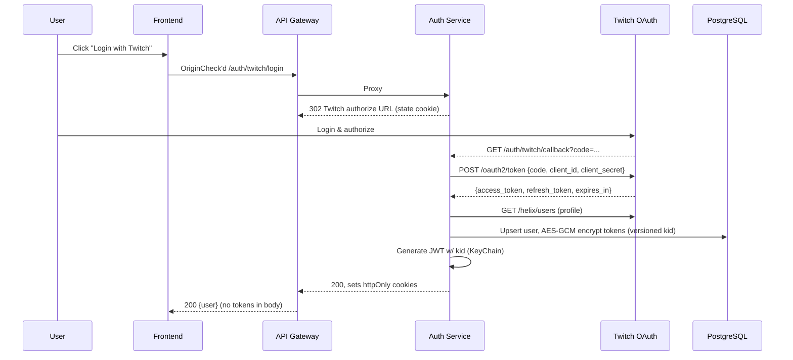
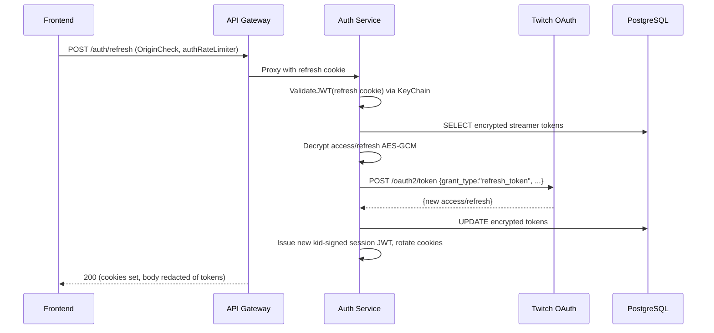

# All-Chat: Security Architecture

**Version:** 2.0
**Last Updated:** 2026-11-04
**Related Docs**: [Architecture Overview](./00-OVERVIEW.md), [Deployment](./02-DEPLOYMENT.md), [Security Audit Residuals](../security/RESIDUALS.md)

---

## Table of Contents

1. [Introduction](#introduction)
2. [Authentication](#authentication)
3. [Authorization](#authorization)
4. [Multi-Platform OAuth](#multi-platform-oauth)
5. [API Security](#api-security)
6. [Data Protection](#data-protection)
7. [Network Security](#network-security)
8. [Secrets Management](#secrets-management)
9. [Security Best Practices](#security-best-practices)
10. [Threat Model](#threat-model)
11. [Compliance](#compliance)

---

## Introduction

All-Chat implements defense-in-depth security across multiple layers:
- **Authentication**: OAuth 2.0 + cookie/JWT sessions (streamers, viewers, devices, personal access tokens)
- **Authorization**: feature gates (`feature_gates`), premium/early-access middleware, resource ownership checks, delegated overlay moderators
- **Data Protection**: AES-GCM token encryption at rest, TLS in transit, versioned key rotation
- **Network Security**: default-deny ingress NetworkPolicies, Envoy Gateway w/ TLS via cert-manager, SSRF-safe outbound fetches
- **Secrets Management**: encrypted Kubernetes Secrets (ksops/sops) in `caesar-deployment` (GitOps), no plain secrets committed

Known gaps and residual work are tracked in `docs/security/RESIDUALS.md` (cross-referenced from `docs/security/SECURITY_AUDIT_REPORT.md`); notably, service-to-service HMAC signing is implemented in `shared/signing/` but **not wired into any production service** — Kubernetes NetworkPolicies are the current isolation control.

---

## Authentication

### Session Flow (httpOnly cookies)

Streamer login uses the same cookie-based flow the audit recommended (`shared/auth/cookie.go`):
`httpOnly; Secure; SameSite=Lax` cookies carry the access JWT (Path=/) and the refresh JWT (Path=/api/v1/auth/). The auth-service `/exchange` endpoint sets both cookies, rotates them via `/refresh`, and `/logout` clears cookies and revokes the refresh token. CSRF defense is SameSite=Lax plus the shared `OriginCheck` middleware on every state-changing route; a `SameSite=Strict` variant is not used. Personal access tokens (Stream Deck / StreamController desktop plugins, ADR-0051) and paired device tokens (ADR-0049) are long-lived `Authorization: Bearer` credentials that resolve to the same request identity a session JWT populates — never a second authorization path.



### JWT Structure (KeyChain)

JWTs are signed with HS256 secrets dispatched by `kid` header, with a legacy fallback secret for tokens issued before the versioned scheme (audit D-08). Issued by `shared/auth/jwt.go`:

```json
{
  "header": {
    "alg": "HS256",
    "kid": "v2",
    "typ": "JWT"
  },
  "payload": {
    "user_id": "uuid",
    "twitch_id": "12345678",
    "username": "streamer123",
    "roles": ["user"],
    "impersonated_by": "<admin user id, absent otherwise>",
    "impersonated_user": "<target uuid, absent otherwise>",
    "jti": "...",
    "iat": 1762200000,
    "exp": 1762286400
  }
}
```

`JWT_SECRET_V1` (and optional `JWT_SECRET` legacy fallback) is read at boot by `shared/auth.NewKeyChainFromEnv`. All sign/verify helpers exist in HMAC-with-kid and legacy plain-secret forms. Secrets and encryption keys are mounted from the `allchat-secrets` secret produced by ksops (see Secrets Management).

**Required minimum length**: each chain secret shorter than 32 bytes is rejected at boot (`ErrSecretTooShort`, `minSecretBytes = 32`), and a chain without any `<PREFIX>_V1` fails with `ErrNoVersionedJWTSecrets` (audit M3).

### JWT Validation Middleware

`shared/middleware.JWTAuthWithRevocation(keyChain, redis)` is the standard middleware every production service that serves authenticated routes uses (api-gateway, auth-service, engagement-service, moderation-service, overlay-manager, payment-service, share-service, media-service). It

- selects the (kid) secret per-token via KeyChain's `KeyFunc`, falling back to the legacy secret for kid-less tokens;
- rejects non-HMAC algorithms;
- checks `blacklist:<token>` in Redis and fails **closed** (audit H2: token logout revocation now enforced everywhere);
- populates `user_id`, `username`, `roles`, `is_admin`, and impersonation provenance (`GetEffectiveUserID`/`GetActualUserID`) into the request context.

A separate viewer keychain authenticates viewer (extension/overlay) JWTs via `ValidateViewerJWT` (`ViewerClaims`: `viewer_id`, `session_id`, `platform`, `platform_user_id`, `is_viewer`, `is_premium`, `is_admin`).

### Token Refresh Flow



Key (V1) rotation: to grace, the old `JWT_SECRET` continues verifying until every issued access/refresh JWT that references it expires or is revoked; new JWTs carry the new `kid`.

---

## Authorization

### Role-Based Access Control

| Role | Value | Assigned To |
|------|-------|-------------|
| `user` | default (every signed-in streamer) | all authenticated users |
| `admin` | elevated (admin UIs, user list, impersonation, feature-gate admin, data export) | platform administrators |

`users.is_admin` is serialised straight into the JWT's `isAdmin` / `roles` (roles = `["user"]` plus `["admin"]` when admin); `shared/middleware.auth.IsAdminSession` checks it server-side. Auth-service exposes admin-only endpoints (impersonation, list-users, stats, viewerviewing, cosmetics, feature gates) behind `IsAdminSession` middleware. Admin-impersonation JWTs carry `ImpersonatedBy` and `ImpersonatedUser` claims; `GetEffectiveUserID` resolves the impersonated target so the real admin's ID remains in the audit log for every action. Routes refused under impersonation include `/auth/me` updates and token-disabling endpoints; see `services/auth-service/README.md` (4xx 403 comments).

### Feature Gates (Premium / Early Access)

`shared/middleware.RequirePremium(db, gates, featureKey)` and `RequireEarlyAccess(...)` enforce the `feature_gates` table (ADR-0008) on top of the JWT session. Gate cache **fails closed** (unknown key ⇒ premium required). Managed through the feature-gate admin endpoint in share-service.

### Resource Ownership

Overlay ownership is enforced server-side in overlay-manager (owner of record's `UserID` handles every mutation). Additional ownership invariants:

- **Delegated overlay moderators** (ADR-0048, migration 080): `overlay_moderators` grants write-access to specific moderator users, gated on the **overlay owner's** premium entitlement (`alerts`/`moderation` feature gates keyed on the overlay owner, not the caller). Moderator routes exist only on moderation-service (`/moderation/overlays/:id/...`); the acting platform credential is always the moderator's own OAuth token — never the owner's and never a shared bot — no fallback. Discord is the exception (platform-attested authority: moderation goes through the shared bot, and Discord's per-call re-check is All-Chat's live guild permission check with a 60-second fail-closed cache).
- **Overlay ownership check** in `overlay-manager` handler: overlay `UserID != caller` ⇒ 403.
- **Personal access tokens**: carry identical owner identity plus a *narrowed* scope set (`chat:write`, `engagement:write`); routes further require the specific scope via `RequireAPITokenScope`.
- **Paired device tokens**: additionally overlaid by `RequireDeviceTokenOverlay`, which refuses a device token on an overlay it was not paired against (per-overlay binding from migration 088).

### API Endpoint Authorization

| Endpoint | Auth Required | Check |
|----------|---------------|-------|
| `GET /auth/<platform>/login` | No | state cookie + OriginCheck |
| `GET /auth/<platform>/callback` | No | code exchange |
| `POST /auth/refresh` | Yes (refresh cookie) | authRateLimiter + OriginCheck |
| `POST /auth/exchange` | No | OriginCheck, sets cookies |
| `GET /auth/me` | Yes (JWT cookie) | blacklist-check |
| `GET /overlays` | Yes (JWT/PAT) | resolver-filtered |
| `POST /overlays` | Yes (JWT) | creates for authenticated user |
| `GET /overlays/:id` | Yes (JWT) | owner (or delegated moderator for alerts/moderate subsets) |
| `PUT /overlays/:id` | Yes (JWT) | owner |
| `DELETE /overlays/:id` | Yes (JWT) | owner |
| `/ws/overlay/:id` | Yes (subprotocol / ?token= / ambient cookie) | origin+token; cookie path additionally verifies overlay-owner and falls back to the anonymous OBS feed (see Token Handling) |
| `/alerts/profiles` PUT | Yes (JWT) | owner, premium-gated (`alerts_editor`) |
| `/moderation/...` | Yes (JWT) | owner or delegated moderator |

---

## Multi-Platform OAuth

### Platform OAuth Strategies

| Platform | OAuth Type | Confidential? | Notes |
|----------|-----------|---------------|-------|
| **Twitch** | OAuth 2.0 auth code | yes | base login scopes; add-source adds `user:read:chat`, `user:bot`, `channel:bot`; chat send uses `user:write:chat` (never bundled into login/add-source); delegated moderation re-consents per action (`moderator:manage:chat_messages`, `moderator:manage:banned_users`, `clips:edit`) |
| **YouTube** | OAuth 2.0 auth code | yes | installed-app + web flows; scopes recorded at consent, includes `youtube.force-ssl` for chat-send, `youtube.readonly`, `youtube.force-ssl` for moderator status |
| **Kick** | OAuth 2.0 | yes | streamer identity flow requests only `user:read`; optional advanced-controls re-consent adds `chat:write` (send) and moderation scopes — `moderation:ban` (timeout/ban/unban) and `moderation:chat_message:manage` (single-message delete); see `oauth/kick.go` |
| **TikTok** | none for viewing | no | no live-chat OAuth for read path; legacy `tiktok_oauth_tokens` kept but never refreshed/read |
| **Discord** | OAuth 2.0 (bot + user) | yes | delegated moderation only; platform-attested authority |
| **Facebook / Instagram** | Graph API OAuth | yes | Live comments polling; moderation write-path is FB-only; ADR-0060/0062 |
| **Owncast / GoodGame / Picarto / Altstream** | none (URL / channel-key based) | no | no user credential is stored |

### Token Storage (Versioned AES-GCM)

Every OAuth provider token persists **encrypted with AES-256-GCM** (symmetric) in `*_oauth_tokens` tables using `shared/encryption`. Two variants coexist:

- **Legacy** pre-Phase-14 blobs: `base64(nonce(12B) || ct || tag(16B))` (`AESEncryptor`).
- **Versioned (current)**: `base64([kid 1B][nonce 12B][ct][tag 16B])` (`shared/encryption/versioned.go`), selected by `TOKEN_ENCRYPTION_KEY_V1` (+ optional legacy `TOKEN_ENCRYPTION_KEY` fallback row).

**Key management workflow** (see `services/auth-service/cmd/key-rotator` and the `key-rotator-weekly` CronJob, Sundays 03:00 UTC in caesar-deployment):

1. `TOKEN_ENCRYPTION_KEY_V1` is set in `allchat-secrets` (encrypted via ksops/sops) and mounted into services that require token encryption (auth-service, token-refresh-service, overlay-manager, moderation-service, message-processor etc.).
2. `key-rotator-weekly` sweeps ciphertext rows still encrypted under a non-current key (`current_kid`) and re-encrypts them with the primary. A table can be excluded via `WithSkipTable`.
3. A one-shot manual Job (`key-rotator-job.yaml`, not registered in kustomization) can force a sweep against live rows; the docblock at the top of that file names its runbook-plan origin.
4. A row whose decryption fails under every configured key is logged (row + metric incremented: `rows_skipped`) and left untouched, not overwritten — re-adding the previous key to the chain recovers it.

> **Reminder**: never check key material into git; only mount it via the secret store (`allchat-secrets`, ksops-generated). See `caesar-deployment/apps/workloads/all-chat/secrets/secret-generator.yaml`.

---

## API Security

### Rate Limiting

Shared limiter `shared/ratelimit` (Redis-based sliding window, key prefix configurable, BurstSize defaults to RequestsPerMinute).

- **api-gateway**: global limiter (default 300 req/min/IP/user, `RATE_LIMIT_PER_MINUTE`) plus a **stricter auth limiter** (default 20 req/min/IP, `AUTH_RATE_LIMIT_PER_MINUTE`) applied per-endpoint via `MiddlewareScoped` on `/auth/refresh`, `/auth/exchange`, and every login-style route (audit M7). The auth limiter **fails closed** on Redis outage (`AUTH_RATE_LIMIT_FAIL_CLOSED=true` default) so a Redis outage cannot silently disable the brute-force defence (audit #15).
- **engagement-service** and **moderation-service** each run their own shared ratelimiter on state-changing routes.
- Variance on the shared limiter can be set per-instance via the `Config`; there is no per-CDN tier desk and no public "free/pro/enterprise" tier table — tiers are product entitlements, not distinct limiter configs.

### CORS

`shared/middleware.CORSMiddleware(CORSConfig)` drives the allowlist from `ENVIRONMENT`-specific defaults (prod: `https://allch.at`, `https://www.allch.at`) plus `CORS_ORIGINS`/`CORS_ORIGIN` overrides and a `BROWSER_EXTENSION_ID` chrome-extension entry. `Allow-Credentials: true` is the only mode; a list containing `*` alongside it is refused (audit H9). One shared matcher, `sharedmiddleware.OriginAllowed`, underlies CORS, `OriginCheck` (CSRF) and the WebSocket origin checks (audit M4 — formerly three divergent wildcard rules). WebSocket routes bypass the HTTP CORS middleware and enforce origins in the upgrader instead.

`.env.example` ships localhost dev origins for `CORS_ORIGINS` (the api-gateway's own middleware reads singular `CORS_ORIGIN`); production pods get the list from the `allchat-config` ConfigMap: `https://allch.at,https://beta.allch.at` plus the two extension-allowlist entries served through the shared matcher.

### Control surface

- Rate limits (400, 429), premium/early-access, and state-changing CORS mismatches produce clear JSON errors.
- Input validation is per-handler (gin binding → 400 on failure), not a global HTML-escaping middleware. The repository never string-interpolates user input into SQL; leftover text escaping is frontend-only and not relied upon for safety.
- Parameterised SQL throughout via pgx (`$1`, `$2`, …); no `fmt.Sprintf` SQL anywhere in prod code (`services/.../repository/`). Parameterisation is the SQL-injection defense, not input sanitisation.

---

## Data Protection

### Encryption at Rest

| Data | Encryption | Keys |
|------|-----------|------|
| OAuth tokens in `*_oauth_tokens` | AES-256-GCM, nonce-per-record, kid-prefixed (`shared/encryption`) | `TOKEN_ENCRYPTION_KEY_V1` (+ legacy fallback) in `allchat-secrets` |
| Discord relay webhook URLs (`overlay_chat_sources.config.relay_webhook_url`, ADR-0091) | AES-256-GCM, same versioned key; never returned by the API | `TOKEN_ENCRYPTION_KEY_V<n>` on discord-listener |
| PostgreSQL data files/WAL | Barman Cloud backup to Hetzner Object Storage (bucket versioning on); the Backblaze B2 copy is paused, so Hetzner is the only off-cluster copy; credentials placed via sops-encrypted `backup-credentials.enc.yaml` (own Secret, not `allchat-secrets`) | Barman |
| Redis 7 (AOF) | not encrypted at rest; isolation is NetworkPolicy only | n/a |
| MinIO media | S3 API on media.allch.at via the Envoy Gateway; bucket root credentials in `allchat-secrets` (ksops); object server on a single-tenant pod (in-namespace service, see `minio-service.yaml`) | MinIO/pod backend keys |
| Audit/PII/logging | client IPs logged **truncated**: IPv4 last octet zeroed, IPv6 → /48 (`shared/middleware/ipanon.AnonymizeIP`) — applied in gateway logging, emote-service, overlay-manager YouTube handler. Edge (Envoy Gateway) additionally logs **no client IPs at all** to keep the Loki pipeline consistent with the privacy policy. | Anonymisation is the DSGVO data-minimisation control |

### Encryption in Transit

- **External**: HTTPS via Envoy Gateway (ADR-0083), TLS 1.2+ with `cert-manager` Let's Encrypt DNS-01 (Cloudflare). Front-end proxy (Cloudflare) terminates first hop; gateway terminates second hop. HSTS (max-age 1 y, includeSubDomains, preload), `X-Content-Type-Options`, `Referrer-Policy`, `X-Frame-Options` set by `shared/middleware.SecurityHeaders` on upstream services.
- **Internal cluster**: plain HTTP on the ClusterIP network; Namespace NetworkPolicies (default-deny-ingress per-workload) is the isolation control. `shared/signing` (HMAC-SHA256 over method+path+query+service name+timestamp, constant-time compare — hardened per audit L2/M4/M5) is **implemented but not wired into any production service**; `grep shared/signing services/` = 0 prod imports. Documented deferral in `docs/security/RESIDUALS.md`.
- **PostgreSQL**: CNPG certificates.
- **Redis**: no TLS; network-isolated via NetworkPolicy (no Redis AUTH in prod today; see below).

### Data Retention

`services/auth-service/cmd/retention-sweeper` (ADR-0089) runs as a **15-minute CronJob** in caesar-deployment (`retention-sweeper-cronjob.yaml`, concurrencyPolicy=Forbid, backoffLimit=0). Policy, per ADR-0089:

| Data | Retention | Mechanism |
|------|-----------|-----------|
| `viewer_message_history` | 1 hour | retention-sweeper |
| `youtube_quota_audit_log`, `alert_events` | 30 days | retention-sweeper |
| `moderation_actions` | 90 days | retention-sweeper |
| `device_link_requests` | expired + 1 h, only if no token minted | retention-sweeper |
| legacy/never-read OAuth creds (`tiktok_oauth_tokens`, legacy `kick_oauth_tokens` rows, expired `instagram_oauth_tokens`) | 7 days past expiry (per-table "dead" rule) | retention-sweeper |
| other OAuth credential rows | until account delete (cascades from `users`) | FK cascade |
| users / overlays | until `DELETE /auth/me` | hard delete, cascade |
| logs | retained in Loki with its own retention policy (`apps/platform/allchat-monitoring`) | Loki retention |
| metrics | Prometheus retention | kube-prometheus-stack |

The sweeper batches deletions (`DELETE ... WHERE id IN (...) LIMIT $1 FOR UPDATE SKIP LOCKED`) with no locks held across transactions, is idempotent and safe to re-run and to run concurrently.

---

## Network Security

### Kubernetes Network Policies (caesar-deployment)

`apps/workloads/all-chat/network-policies.yaml` applies, per workload selector:
- `default-deny-ingress` — namespace-wide rule that every workload's ingress rules build on. Egress is namespace-open except where noted.
- Per-workload ingress selectors for api-gateway, auth-service, overlay-manager, share-service, moderation-service, message-processor, emote-service, listeners, source-manager, token-refresh-service, support-bot, discord-bot, youtube-quota-monitor, PostgreSQL (CNPG), MinIO (S3 API via media.allch.at through the Envoy gateway), redis / redis-haproxy / redis-nodes / sentinels, frontend, and the monitoring namespace's Prometheus-facing ports.
- `redis-ha-networkpolicy.yaml` (HA path): ingress to `redis-node` from HAProxy/Sentinel/peer nodes only; `redis-haproxy` from all namespace pods; `redis-sentinel` from peers + HAProxy.
- No default-deny-egress today: egress to Postgres/Redis/external APIs is unrestricted for most workloads (see note in network-policies.yaml — accepting per-service egress maturity is a documented residual risk).

### Firewall (cluster edge)

The single public entry point is the Envoy Gateway `public` HTTPRoute on https (port 443), served through Cloudflare with cert-manager TLS (`allch.at` and `*.allch.at`). No legacy `Ingress`/nginx gateway remains in production.

### SSRF control

Outbound fetches of **user-chosen URLs** go through `shared/safehttp`: refuses every non-public IP (private ranges, CGNAT, link-local, protocol-assignment block, ULA, metadata endpoint) at dial time, after DNS resolution, and on every redirect hop, never via a proxy. Used by `{urlfetch}` in engagement-service chat commands (https:// port 443 only, ADR-0080) and Owncast instance-URL ingestion (ADR-0058). This is the application-level guard; no egress NetworkPolicy exists yet (ENG1 residual in RESIDUALS).

---

## Secrets Management

### Encrypted-Secrets in Git (ksops/sops)

Durable secrets live **encrypted** inside `caesar-deployment/apps/workloads/all-chat/secrets/*.enc.yaml` (sops-encrypted, sealed via the `ksops` kustomize generator, decrypted server-side by the ArgoCD ksops plugin). Values include `database-password`, `jwt-secret`/`jwt-secret-v1`, `service-jwt-secret`/`service-jwt-secret-v1`, `token-encryption-key-v1` (and legacy), MinIO root credentials, Hetzner HS ObjectStore + B2 keys, Twitch/Patreon/Meta/Google/Key/Kick/Discord API keys as needed. plaintext is never committed and shown only inside the cluster.

### In-Cluster Secret (allchat-secrets)

Generated by ksops at sync time; referenced via `secretKeyRef` in each Deployment. Rotation workflow:

1. Re-seal `secrets/allchat-secret.enc.yaml` with the new value(s).
2. ArgoCD syncs, the ksops plugin re-encrypts into `allchat-secrets`.
3. Relevant Deployments restart on secret change (reloader); consumers pick it up.
4. For token-encryption secrets the `key-rotator-weekly` CronJob (Sundays 03:00 UTC) sweeps `*_oauth_tokens` ciphertext columns and re-encrypts rows still under the legacy `TOKEN_ENCRYPTION_KEY` / `YOUTUBE_TOKEN_ENCRYPTION_KEY` with `TOKEN_ENCRYPTION_KEY_V1`. It is a `cmd/key-rotator` binary in the auth-service image and does **not** touch JWT secrets; JWT rotation is the operator resealing `jwt-secret-v1` plus the grace window of the previous secret in `JWT_SECRET`.

### Revocation & logout

Refresh and access cookies (`access_token`, `refresh_token`) are revocable: `JWTAuthWithRevocation` blacklist checks fail-closed on Redis outage (H2). Logout clears both cookies and blacklists the session in Redis.

---

## Security Best Practices

### Pod Security

Every workload in caesar-deployment carries a pod-level securityContext (audit H6 closed):
`runAsNonRoot: true, runAsUser: 1000, runAsGroup: 1000, fsGroup: 1000, seccompProfile RuntimeDefault`; containers drop `ALL` capabilities, `allowPrivilegeEscalation: false`, and mount a writable `/tmp` emptyDir against `readOnlyRootFilesystem: true` (StatefulSets/containers needing scratch space opt out individually).

### Image hygiene

Images pin `ghcr.io/caesarakalaeii/allchat-*:main`, `alpine:3.24.3`, `redis:7.4.12-bookworm`, `postgres:16-alpine` etc. — mutable tags remain (audit M13 residual), mitigated by ArgoCD self-heal + Keel poll or upstream tag rotation. `dependabot-auto-merge.yml` plus a weekly `security-scan.yml` (govulncheck on every Go module, reachable-vulnerability gate, npm audit on the frontend/subprojects) continuously scan.

### Body / read / WS limits

- HTTP request body capped by `shared/middleware.body_limit` in content-type-JSON routes.
- WebSocket `SetReadLimit(MaxMessageSize)` is called on every gateway WS connection (audit H1 closed).
- JWT validation middlewares reject anonymous tokens before any goroutine fan-out.

### Data in transit (transport)

CSP is per-route at the frontend (Next.js), never widened globally — the alerts custom-code sandbox (ADR-0071) relies on the overlay page's existing `script-src 'self' 'unsafe-inline'` and an `<iframe sandbox="allow-scripts" srcdoc>` with opaque origin; the gateway never relays streamer custom code outside that sandbox. `frame-ancestors` is not set globally at the edge today (residual M10 remainder), but each overlay page sets appropriate directive via Next.js headers.

---

## Threat Model

### Threat: Token Theft

**Vector**: XSS, man-in-the-middle, or extension-origin exfiltration.
**Mitigations**:
- httpOnly cookies (`Secure; SameSite=Lax`) carry both JWTs — a successful XSS cannot read them; SameSite=Lax plus shared `OriginAllowed` OriginCheck provides CSRF defense (audit H3 closed).
- Cookie-jar degradation rules on the owner overlay WS keep extensions from riding ambient cookies.
- Strict first-party origin gate for cookie-authenticated WS, permissive-origin fallthrough only for token-path clients (audit #8 / M8 / I1).
- OAuth codes never land in `#fragment`; streamer OAuth uses a short-lived `?code=` exchange through Redis (M1).
- DevicePAT and paired-device plaintexts are never shown or persisted (`allchat_dev_` only travels the browser-linking loopback).

### Threat: Privilege Escalation via /internal Endpoints

**Vector**: an unauthenticated caller hitting auth-service `/internal/chat/announce` (`/internal/chat/bot-send`, `/internal/twitch/clip`) and acting as any streamer.
**Mitigation**: those routes are registered **only** when `SERVICE_JWT_SECRET[(_V1)]` is set, and are enforced by `ServiceJWTAuth(serviceKeyChain, "engagement-service")` — an independent KeyChain from the user one. A wide internal surface (extra risk of service-JWT compromise turning into arbitrary-chat-send) is documented as residual risk ENG1 in `docs/security/RESIDUALS.md`.

### Threat: DDoS / DoS

**Vector**: connection or CPU exhaustion.
**Mitigations**: WS `SetReadLimit` (audit H1), auth limiter fail-closed (audit #15), gateway global rate limit, per-pod HPAs (api-gateway, kick-listener, twitch-listener, platform-listeners), PDBs, and Cloudflare-level protection at the edge.

### Threat: DB Breach

**Vector**: SQL injection, direct Postgres access, stolen backup.
**Mitigations**: parameterised pgx queries everywhere; the CNPG NetworkPolicy restricts ingress to the allow-listed callers (plus the `cnpg-system` operator); every `*_oauth_tokens` column is AES-256-GCM under versioned keys; backups go to Hetzner Object Storage (versioned bucket), their creds sealed via sops; session JWTs are httpOnly cookies and expire.

### Threat: SSRF via user-chosen URL

**Vector**: `{urlfetch https://internal…}` or a hostile Owncast URL reaching metadata/private address space.
**Mitigation**: `shared/safehttp` refuses every non-public dial target at dial time (post-DNS, per redirect hop) — plus https-only/443-only enforcement in `{urlfetch}`. No egress NetworkPolicy exists yet, so a new code path bypassing safehttp is the exposure (ENG1 residual).

---

## Compliance

### GDPR / CCPA

| Requirement | Implementation |
|-------------|----------------|
| Right to Access | `GET /auth/me/data-export` (streamer) and `GET /auth/viewer/data-export` (viewer) section-structured JSON; "Download my data" cards on `/settings` and `/settings/viewer` (contents enumerated in `services/auth-service/README.md` → data export) |
| Right to Deletion | `DELETE /auth/me` hard-cascades; retention-sweeper removes per-table quotas |
| Data Portability | Same JSON export (attachment `Content-Disposition`) |
| Consent | OAuth authorization flow; viewer consent / ToS stamps |
| Data Minimisation | IP anonymisation (`shared/middleware/ipanon`), streaming meta not stored beyond overlay logs; edge logs no client addresses at all |
| Encryption | AES-256-GCM tokens at rest, TLS via cert-manager at the edge |

CCPA "Right to Opt-Out" is the data-minimisation story (no analytics dump → nothing to opt out of).

### SOC 2 (future)

- Continuous audit trail: moderation actions, impersonations, feature-gate changes.
- Automated vulnerability scanning (`security-scan.yml`, dependabot).
- Operational reviews (the ADR process and the `docs/security/` corpus).

---

## Summary

Controls as implemented today (see `docs/security/RESIDUALS.md` for the deliberately deferred list):

1. **Authentication** — OAuth 2.0 + cookie/JWT (KeyChain, kid rotation), viewer tokens, paired-device and personal access tokens.
2. **Authorization** — feature gates, premium/early-access middleware, ownership checks, delegated-moderator per-overlay grants (ADR-0048).
3. **Multi-Platform OAuth** — Twitch/YouTube/Kick/Discord/Facebook/Instagram (+ no-auth read-only sources).
4. **API Security** — per-service Redis-backed rate limiting (auth limiter fails closed), env-driven CORS/OriginCheck, request-body limits, WS read limits.
5. **Data Protection** — AES-256-GCM token encryption with kid versions, retention-sweeper (ADR-0089), IP anonymisation, MinIO bucket via in-namespace service.
6. **Network Security** — default-deny-ingress NetworkPolicies, Envoy Gateway TLS (ADR-0083), cert-manager, SafeHTTP SSRF guard.
7. **Secrets Management** — ksops/sops encrypted Git secrets, `key-rotator-weekly` CronJob, multi-key chains for rotation.
8. **Best Practices** — pod securityContext everywhere, image pinning at digest-ish tags, govulncheck + dependabot, body limits.
9. **Tracked residuals** — `shared/signing` implemented-but-unwired (L2), `/internal/chat/*` breadth (ENG1), no default-deny-egress (ENG1), M2 refresh-token family revocation, OBS unauthenticated overlay socket (L13, accepted), `gorilla/websocket` pseudo-version pinning (S3).

**Next**: [Security Audit Residuals](../security/RESIDUALS.md), [Deployment](./02-DEPLOYMENT.md)

---

**Document Maintainers**: Security Team
**Last Review**: 2026-11-04
